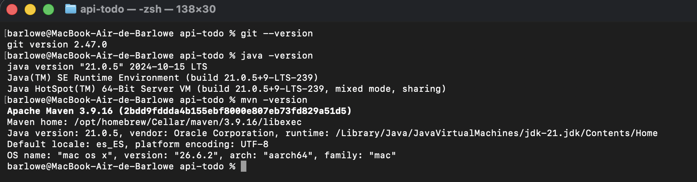
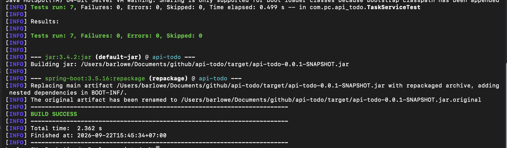
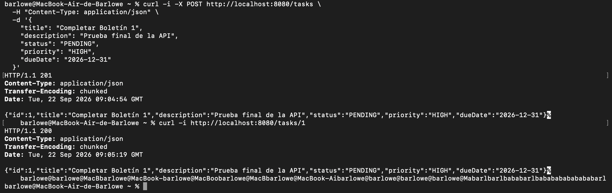
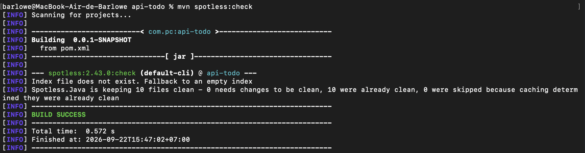
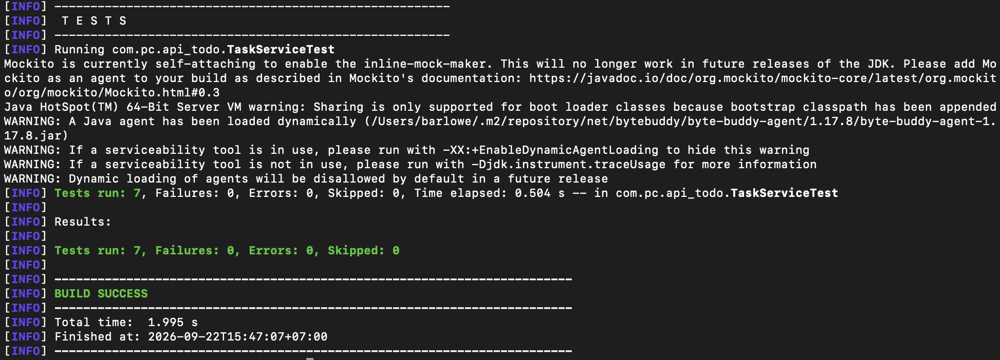
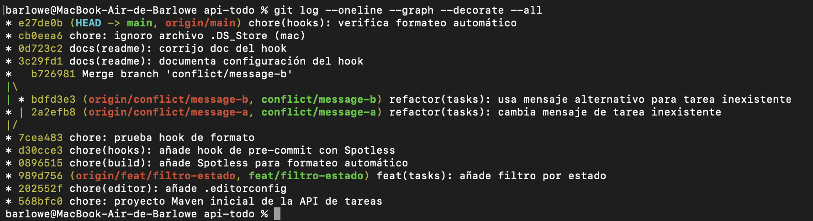

# Boletín 1 — Git y proyecto Maven

## Resumen de commits

| #   | Mensaje del commit                                                | Qué se hizo                                                                           | Autor  | Enlace                                                                                           |
| --- | ----------------------------------------------------------------- | ------------------------------------------------------------------------------------- | ------ | ------------------------------------------------------------------------------------------------ |
| 1   | `chore: proyecto Maven inicial de la API de tareas`               | Proyecto inicial Spring Boot/Maven con API REST, JPA/H2 y tests unitarios.            | Adri R | [568bfc0](https://github.com/Barlowe90/api-todo/commit/568bfc092488db72303852b0b45a0d5437a0b820) |
| 2   | `chore(editor): añade .editorconfig`                              | Configuración común del editor.                                                       | Adri R | [202552f](https://github.com/Barlowe90/api-todo/commit/202552f8c20bb62507473488413f16ddaf984020) |
| 3   | `feat(tasks): añade filtro por estado`                            | Funcionalidad en rama independiente para filtrar tareas por estado.                   | Adri R | [989d756](https://github.com/Barlowe90/api-todo/commit/989d75651fe6398583250dad24c021eb0761ceab) |
| 4   | `chore(build): añade Spotless para formateo automático`           | Configuración de Spotless con Google Java Format.                                     | Adri R | [0896515](https://github.com/Barlowe90/api-todo/commit/089651521967e7e04cf9d0bc847504e79b4e2b60) |
| 5   | `chore(hooks): añade hook de pre-commit con Spotless`             | Hook versionado que ejecuta Spotless antes de cada commit.                            | Adri R | [d30cce3](https://github.com/Barlowe90/api-todo/commit/d30cce30a6a15c82273ac172a42ef3e839fdf926) |
| 6   | `chore: prueba hook de formato`                                   | Primer intento de comprobar el hook; el commit quedó vacío al restaurarse el formato. | Adri R | [7cea483](https://github.com/Barlowe90/api-todo/commit/7cea48382b201f8a392a12d24690857d7d38889a) |
| 7   | `refactor(tasks): cambia mensaje de tarea inexistente`            | Primera rama usada para provocar un conflicto.                                        | Adri R | [2a2efb8](https://github.com/Barlowe90/api-todo/commit/2a2efb85f3797394af1b14dc0bd3b5972b44bff8) |
| 8   | `refactor(tasks): usa mensaje alternativo para tarea inexistente` | Segunda rama modificando la misma línea.                                              | Adri R | [bdfd3e3](https://github.com/Barlowe90/api-todo/commit/bdfd3e37207e58af33fcb99f8dfa6fcf0bc4d4ba) |
| 9   | `Merge branch 'conflict/message-b'`                               | Resolución manual del conflicto y cierre de la fusión.                                | Adri R | [b726981](https://github.com/Barlowe90/api-todo/commit/b72698109c4a79596c8c70a5d21edc0fd50bb0d2) |
| 10  | `docs(readme): documenta configuración del hook`                  | Documentación de `core.hooksPath` en el README.                                       | Adri R | [3c29fd1](https://github.com/Barlowe90/api-todo/commit/3c29fd185fd1fe20e0724ad9e404c04392483bb9) |
| 11  | `docs(readme): corrijo doc del hook`                              | Corrección del bloque Markdown y explicación del hook.                                | Adri R | [0d723c2](https://github.com/Barlowe90/api-todo/commit/0d723c28046b4af7154660db26bc7b6a15d1a67b) |
| 12  | `chore: ignoro archivo .DS_Store (mac)`                           | Se añade `.DS_Store` al `.gitignore`.                                                 | Adri R | [cb0eea6](https://github.com/Barlowe90/api-todo/commit/cb0eea6d4555045771f74b86379b9725163913f6) |
| 13  | `chore(hooks): verifica formateo automático`                      | Verificación final del hook con un cambio real formateado por Spotless.               | Adri R | [e27de0b](https://github.com/Barlowe90/api-todo/commit/e27de0bc880da8737f7fef38c29bab0a4cf88bd9) |

---

## Detalle por commit

### 1. `chore: proyecto Maven inicial de la API de tareas`

- **Qué se hizo:** se creó una API REST de gestión de tareas utilizando Java 21, Spring Boot 3.5.16 y Maven.
- **Persistencia:** Spring Data JPA con H2 en memoria.
- **Estructura:** separación entre controlador, servicio y repositorio.
- **Dominio:** entidad `Task` con identificador, título, descripción, estado, prioridad y fecha límite.
- **Validaciones:** se añadieron validaciones mediante Jakarta Bean Validation.
- **CRUD:** se implementaron las operaciones de creación, consulta, actualización y eliminación.
- **Errores:** se añadió manejo centralizado de errores y respuesta HTTP 404 para tareas inexistentes.
- **Tests:** se crearon tests unitarios del servicio con JUnit 5 y Mockito, sin levantar el contexto de Spring ni una base de datos.
- **Relación con el boletín:** Partes B y C.
- **Uso de IA:** se utilizó ChatGPT para guiar la estructura del proyecto, revisar el `pom.xml`, implementar las capas de la aplicación y preparar los tests unitarios. Todo el código generado fue revisado antes de incorporarlo.

Antes de crear este commit se verificó el entorno:

- Git 2.47.0.
- Java 21.0.5.
- Maven 3.9.16 utilizando Java 21.

También se configuró Git con:

```bash
git config --global user.name "Adri R"
git config --global user.email "adrian.r.r@um.es"
git config --global pull.ff only
git config --global init.defaultBranch main
```

La aplicación se comprobó mediante:

```bash
mvn clean test
mvn clean package
```

El empaquetado generó:

```text
target/api-todo-0.0.1-SNAPSHOT.jar
```

Se comprobó que el JAR era ejecutable:

```bash
java -jar target/api-todo-0.0.1-SNAPSHOT.jar
```

Después se creó una tarea mediante `POST /tasks`, obteniendo HTTP `201`, y se recuperó mediante `GET /tasks/1`, obteniendo HTTP `200`.

---

### 2. `chore(editor): añade .editorconfig`

- **Qué se hizo:** se añadió un archivo `.editorconfig` para unificar la configuración básica de los editores.
- **Configuración principal:** UTF-8, finales de línea LF, espacios y cuatro espacios de indentación general.
- **Relación con el boletín:** Parte D.
- **Uso de IA:** ChatGPT indicó el contenido especificado por el boletín.

---

### 3. `feat(tasks): añade filtro por estado`

- **Qué se hizo:** se creó la rama:

```bash
git switch -c feat/filtro-estado
```

y se añadió la posibilidad de filtrar tareas mediante:

```text
GET /tasks?status=PENDING
```

Para ello se modificaron las capas de repositorio, servicio y controlador y se añadió un test unitario.

La funcionalidad se integró posteriormente en `main` mediante un merge _fast-forward_.

- **Relación con el boletín:** Parte D, creación de una rama y realización de un cambio pequeño pero no trivial.
- **Uso de IA:** ChatGPT propuso el filtro por estado como funcionalidad y proporcionó una implementación que fue revisada antes de incorporarse.

---

### 4. `chore(build): añade Spotless para formateo automático`

- **Qué se hizo:** se añadió al `pom.xml` el plugin `spotless-maven-plugin` versión `2.43.0`.
- **Configuración:** Google Java Format, eliminación de imports no utilizados, espacios finales y normalización del salto de línea final.
- **Comprobación:**

```bash
mvn spotless:check
```

produjo `BUILD SUCCESS`.

- **Relación con el boletín:** Parte E.
- **Uso de IA:** ChatGPT guió la incorporación de la configuración indicada literalmente por el boletín.

---

### 5. `chore(hooks): añade hook de pre-commit con Spotless`

- **Qué se hizo:** se creó `.githooks/pre-commit` con:

```sh
#!/bin/sh
echo "Formatting with Spotless..."
mvn -q spotless:apply || exit 1
git add -u
```

Se hizo ejecutable y se configuró Git para utilizar la carpeta versionada:

```bash
chmod +x .githooks/pre-commit
git config core.hooksPath .githooks
```

- **Relación con el boletín:** Parte E.
- **Uso de IA:** ChatGPT guió la ejecución de los comandos indicados en el boletín.

---

### 6. `chore: prueba hook de formato`

- **Qué se hizo:** se realizó un primer intento de comprobar el hook desordenando el formato de una clase Java antes de hacer commit.
- **Resultado:** el hook ejecutó `mvn spotless:apply` y restauró exactamente el contenido previo, por lo que el commit resultante quedó vacío (0 cambios).
- **Conclusión:** este commit demuestra que el hook llegó a ejecutarse, pero no deja evidencia suficiente del archivo reformateado en el diff. Por ello se realizó posteriormente una segunda comprobación válida en el commit `e27de0b`.
- **Relación con el boletín:** Parte E.
- **Uso de IA:** ChatGPT indicó cómo realizar la prueba y, al revisar posteriormente el historial en GitHub, detectó que este primer commit no contenía cambios.

---

### 7. `refactor(tasks): cambia mensaje de tarea inexistente`

- **Qué se hizo:** desde `main` se creó la rama `conflict/message-a` y se modificó el mensaje de `TaskNotFoundException`.
- **Objetivo:** preparar la primera de las dos modificaciones necesarias para provocar un conflicto.
- **Relación con el boletín:** Parte F.
- **Uso de IA:** ChatGPT indicó una modificación sencilla de una misma línea para reproducir de forma controlada el conflicto requerido.

---

### 8. `refactor(tasks): usa mensaje alternativo para tarea inexistente`

- **Qué se hizo:** desde el mismo punto de `main` se creó `conflict/message-b` y se modificó de otra forma exactamente la misma línea.
- **Resultado:** las ramas quedaron divergentes.
- **Relación con el boletín:** Parte F.
- **Uso de IA:** ChatGPT guió la creación de la segunda rama.

---

### 9. `Merge branch 'conflict/message-b'`

Se fusionó primero `conflict/message-a` en `main`.

Al intentar fusionar posteriormente:

```bash
git merge conflict/message-b
```

Git detectó el conflicto:

```text
CONFLICTO (contenido): Conflicto de fusión en
src/main/java/com/pc/api_todo/service/TaskNotFoundException.java
```

Se abrió el archivo y se eliminaron manualmente los marcadores:

```text
<<<<<<<
=======
>>>>>>>
```

Después se marcó la resolución:

```bash
git add src/main/java/com/pc/api_todo/service/TaskNotFoundException.java
git commit
```

El resultado quedó reflejado en el grafo:

```text
*   b726981 (HEAD -> main) Merge branch 'conflict/message-b'
|\
| * bdfd3e3 (conflict/message-b) refactor(tasks): usa mensaje alternativo para tarea inexistente
* | 2a2efb8 (conflict/message-a) refactor(tasks): cambia mensaje de tarea inexistente
|/
* 7cea483 chore: prueba hook de formato
```

Después de resolver el conflicto se ejecutaron de nuevo los tests:

```text
Tests run: 7, Failures: 0, Errors: 0, Skipped: 0
BUILD SUCCESS
```

- **Relación con el boletín:** Parte F completa.
- **Uso de IA:** ChatGPT guió los pasos para provocar, identificar y resolver el conflicto, mientras que la resolución se realizó manualmente.

---

### 10. `docs(readme): documenta configuración del hook`

- **Qué se hizo:** se añadió al `README.md` la configuración necesaria después de clonar el repositorio:

```bash
git config core.hooksPath .githooks
```

Esto es necesario porque `core.hooksPath` es una configuración local de Git y no se transmite al clonar el repositorio.

- **Relación con el boletín:** Parte E.
- **Uso de IA:** ChatGPT detectó este requisito al hacer la comprobación final del boletín.

---

### 11. `docs(readme): corrijo doc del hook`

- **Qué se hizo:** se corrigió el bloque de código Markdown del README y se añadió una explicación breve del efecto del hook.
- **Relación con el boletín:** Parte E, documentación de la configuración del repositorio.
- **Uso de IA:** ChatGPT revisó el README publicado en GitHub y detectó que el bloque de código no estaba cerrado correctamente.

---

### 12. `chore: ignoro archivo .DS_Store (mac)`

- **Qué se hizo:** se añadió `.DS_Store` al `.gitignore` para evitar versionar archivos generados automáticamente por macOS.
- **Relación con el boletín:** mantenimiento del repositorio; no es un requisito específico del boletín.
- **Uso de IA:** ChatGPT recomendó ignorar este archivo al aparecer como no seguido en `git status`.

---

### 13. `chore(hooks): verifica formateo automático`

- **Qué se hizo:** se repitió la prueba del hook de pre-commit con una modificación real en `TaskService.java` y con indentación deliberadamente incorrecta.
- **Resultado:** al ejecutar el commit apareció `Formatting with Spotless...` y Spotless corrigió el formato antes de crear el commit.
- **Evidencia:** el commit contiene una inserción real y el diff muestra el comentario correctamente indentado por Spotless.
- **Comprobación posterior:**

```text
Spotless.Java is keeping 10 files clean
BUILD SUCCESS

Tests run: 7, Failures: 0, Errors: 0, Skipped: 0
BUILD SUCCESS
```

Durante un primer reintento, Maven estaba utilizando Java 27 porque `JAVA_HOME` no estaba establecido en esa sesión y `google-java-format` falló por incompatibilidad. Se volvió a fijar `JAVA_HOME` a Java 21 y la comprobación terminó correctamente.

- **Relación con el boletín:** Parte E, prueba efectiva del hook de pre-commit.
- **Uso de IA:** ChatGPT ayudó a diagnosticar que Maven estaba usando Java 27, indicó cómo volver a Java 21 y propuso repetir la prueba dejando una evidencia real en el commit.

---

## Descripción narrativa de la sesión

### Parte A — Instalación y verificación del entorno

Se comprobaron las versiones de Git, Java y Maven.

Inicialmente `java -version` utilizaba Java 21 pero Maven estaba utilizando Java 27. Se diagnosticó que `JAVA_HOME` no estaba establecido y se configuró temporalmente:

```bash
export JAVA_HOME=$(/usr/libexec/java_home -v 21)
export PATH="$JAVA_HOME/bin:$PATH"
```

Después Maven quedó correctamente asociado a Java 21.



También se configuraron la identidad del usuario de Git, la política `pull.ff only` y `main` como rama inicial.

---

### Parte B — Generación de la aplicación

El proyecto `api-todo` se creó utilizando Spring Initializr.

Se decidió utilizar la alternativa propuesta por el prompt de ejemplo del boletín: **Spring Data JPA/Hibernate con H2 en memoria**.

El proyecto utiliza:

- Java 21.
- Spring Boot 3.5.16.
- Maven.
- Spring Web.
- Spring Data JPA.
- H2.
- Bean Validation.
- JUnit 5 y Mockito.

Se implementó una API REST de tareas con arquitectura por capas, CRUD completo, validaciones y manejo centralizado de errores.

Inicialmente Spring Initializr había creado un test con `@SpringBootTest`. Se eliminó porque el boletín establece expresamente que solo deben existir tests unitarios que no levanten el contexto de Spring ni una base de datos.

Finalmente se crearon siete tests unitarios de la capa de servicio.

---

### Parte C — Construcción y prueba local

Se ejecutó:

```bash
mvn clean package
```

obteniendo correctamente el fat JAR:

```text
target/api-todo-0.0.1-SNAPSHOT.jar
```



La aplicación se arrancó con:

```bash
java -jar target/api-todo-0.0.1-SNAPSHOT.jar
```

Se realizó una petición `POST /tasks`, obteniendo HTTP `201 Created`, y posteriormente un `GET /tasks/1`, obteniendo HTTP `200 OK` y la misma tarea almacenada en H2.



---

### Parte D — Control de versiones

Se inicializó Git y se añadieron `.gitignore`, `.gitattributes` y `.editorconfig`.

Se creó la rama `feat/filtro-estado`, en la que se implementó una funcionalidad adicional no trivial.

Posteriormente se integró en `main` mediante _fast-forward_.

---

### Parte E — Formateo automático

Se configuró Spotless y se comprobaron sus modos de funcionamiento.

También se creó un hook de pre-commit versionado en `.githooks/pre-commit`.

Se comprobó de forma práctica que el hook ejecutaba Spotless antes de completar un commit. El primer intento generó un commit vacío porque Spotless restauró exactamente el contenido previo. Por ello se repitió la prueba con un cambio real en `TaskService.java`; el commit `e27de0b` deja constancia del cambio ya formateado.

Después se ejecutaron `mvn spotless:check` y `mvn clean test`, ambos con `BUILD SUCCESS` y los siete tests superados.





La configuración necesaria después de clonar el repositorio quedó documentada en el `README.md`.

---

### Parte F — Resolución de conflictos

Se crearon dos ramas independientes desde el mismo commit y ambas modificaron de forma distinta la misma línea.

Después de integrar la primera rama, la segunda produjo un conflicto real de Git.

El conflicto se resolvió manualmente eliminando los marcadores generados por Git y se creó el correspondiente merge commit.

Finalmente se ejecutaron de nuevo los siete tests unitarios y todos finalizaron correctamente.



---

## Uso de Inteligencia Artificial

Durante este boletín se utilizó **ChatGPT** como asistente técnico.

Principalmente se le pidió:

- interpretar y seguir paso a paso el Boletín 1;
- revisar la configuración inicial de Spring Initializr y el `pom.xml`;
- ayudar a configurar Maven para utilizar Java 21;
- generar y revisar la estructura de la API REST;
- proponer las capas de controlador, servicio y repositorio;
- generar tests unitarios con JUnit y Mockito;
- guiar el uso de Git, ramas y merges;
- guiar la configuración y comprobación de Spotless;
- ayudar a provocar y resolver un conflicto Git de forma controlada;
- revisar el cumplimiento final de los requisitos del boletín.

Todo el código y los comandos propuestos se revisaron y ejecutaron manualmente antes de incorporarlos.

---

## Capturas de pantalla

Las evidencias gráficas de la sesión se han incorporado en los apartados correspondientes:

- **Parte A:** verificación de Git, Java y Maven.
- **Parte C:** generación correcta del JAR ejecutable.
- **Parte E:** comprobación de Spotless y ejecución de los siete tests unitarios.
- **Parte F:** grafo final de Git con las ramas y el merge.

La ejecución de la API mediante `curl` (POST con HTTP 201 y GET con HTTP 200) se realizó durante la sesión y está descrita en la Parte C. Si se dispone de una captura de estas peticiones, puede añadirse como evidencia adicional.
