# Boletín 1

## Resumen de commits

Los hashes se han contrastado con el historial del repositorio entregado. Se muestran sin enlace porque esa copia no tiene un remoto configurado.

| # | Mensaje del commit | Qué se hizo | Autor | Enlace |
|---|--------------------|-------------|-------|--------|
| 1 | `chore: proyecto Maven inicial de la API de finanzas`        | Generar, construir y probar una aplicación en local y configuración base de git         | Felipe   | `a51bc00` |
| 2 | `chore(editor): añade .editorconfig`        | Añadir .editorconfig para que todos los editores usen la misma indentación         | Felipe   | `b0515f6` |
| 3 | `feat(filtro-fechas): Añade filtrado de movimientos por fechas`        | Implementar la funcionalidad de filtrado de movimientos por fechas.         | Felipe   | `bcac73d` |
| 4 | `chore(build): añade Spotless para formateo automático`        | Se añadió el plugin Spotless al documento de configuración de Maven (pom.xml) y se probaron los modos (mvn spotless:check / mvn spotless:apply) para formateo automático.          | Felipe   | `b61eeaa` |
| 5 | `chore(hooks): prueba de confirmación del formateo 2 )`          | Registra un commit vacío de prueba del hook, incorporado previamente en b61eeaa         | Felipe   | `5ec39ed` |
| 6 | `docs:cambia el título a finanzas personales`                  | Modificar el título del fichero README.md en la rama "refactor/conflicto_1"         | Felipe   | `c1f5f5a` |
| 7 | `docs: cambia el título a gestión de ingresos y gastos`        | Modificar el título del fichero README.md en la rama "refactor/conflicto_2"         | Felipe   | `1bdbebc` |
| 8 | `docs(readme): unifica el título tras resolver el conflicto`   | Resolver el conflicto generado por los dos commits anteriores.         | Felipe   | `0ada0c0` |


## Detalle por commit

### 1. `chore: proyecto Maven inicial de la API de finanzas` — `a51bc00`

- **Qué se hizo:** se generó la aplicación inicial de gestión de gastos e ingresos personales y se incorporó al repositorio junto con la configuración base de Git. El proyecto solicitado utiliza Maven, Java 21 y Spring Boot 3, con una entidad `FinancialTransaction`, operaciones CRUD y separación en controlador, servicio y repositorio. Se definieron validaciones, manejo centralizado de errores y tests unitarios. 
- **Autor:** Felipe
- **Relación con el boletín:** partes B y C, generación y comprobación de la aplicación, y parte D, creación del repositorio y primer commit.
- **Uso de IA:** se utilizó Codex para generar el proyecto a partir del
  [prompt de generación de la API de finanzas](imagenes/boletin1-felipe/prompt-api-gastos-ingresos.md).

### 2. `chore(editor): añade .editorconfig` — `b0515f6`

- **Qué se hizo:** se añadió `.editorconfig` para compartir las preferencias de edición del proyecto y mantener una indentación y unos finales de línea coherentes entre editores. La configuración se registró en un commit independiente por tratarse de una herramienta de desarrollo.
- **Autor:** Felipe
- **Relación con el boletín:** parte D, configuración del repositorio y normalización del estilo de edición.
- **Uso de IA:** se siguió directamente el ejemplo del boletín.

### 3. `feat(filtro-fechas): Añade filtrado de movimientos por fechas` — `bcac73d`

- **Qué se hizo:** se incorporó la funcionalidad de filtrado de movimientos por fechas, que permite acotar las consultas a un periodo. Esta ampliación constituye el cambio pequeño pero no trivial realizado respecto a la aplicación inicial, porque añade un criterio de consulta relacionado con el uso real de la API.
- **Autor:** Felipe.
- **Relación con el boletín:** parte D, desarrollo de una funcionalidad en una rama y posterior integración en `main`.
- **Uso de IA:** se usó Codex para escribir el código y los tests. Se utilizó el prompt [prompt filtrado por fechas](imagenes/boletin1-felipe/prompt-filtro-fechas.md).


### 4. `chore(build): añade Spotless para formateo automático` — `b61eeaa`

- **Qué se hizo:** se añadió el plugin Spotless al `pom.xml` para automatizar el formato del código Java. Se probó `mvn spotless:check`, que comprueba el formato, y `mvn spotless:apply`, que corrige los archivos. Este mismo commit incorporó `.githooks/pre-commit` y el reformateo de los archivos Java, por lo que reúne el plugin, el hook y la aplicación inicial del estilo.
- **Autor:** Felipe
- **Relación con el boletín:** parte E, incorporación y prueba del formateador automático.
- **Uso de IA:** se siguió el boletín.

### 5. `chore(hooks): prueba de confirmación del formateo 2 )` — `5ec39ed`

- **Qué se hizo:** se registró un commit de prueba del hook. La comparación con su padre confirma que este commit no modifica archivos. El script `.githooks/pre-commit` ya se había incorporado en `b61eeaa`, junto con Spotless y el reformateo del código. El commit vacío conserva el hito de la prueba, pero su contenido no demuestra por sí solo la ejecución del hook; esa evidencia debe verse en la salida de terminal.
- **Autor:** Felipe.
- **Relación con el boletín:** parte E, automatización del formato antes de cada commit y comprobación del hook.
- **Uso de IA:** se siguió el boletín

### 6. `docs:cambia el título a finanzas personales` — `c1f5f5a`

- **Qué se hizo:** se cambió el título de `README.md` en la rama `refactor/conflicto_1`. Este cambio preparó una de las dos versiones de la misma línea necesarias para provocar el conflicto.
- **Autor:** Felipe.
- **Relación con el boletín:** parte F, primera modificación del archivo en una rama independiente.
- **Uso de IA:** se siguió el boletín.

### 7. `docs: cambia el título a gestión de ingresos y gastos` — `1bdbebc`

- **Qué se hizo:** se modificó la misma línea de `README.md` con otro título en la rama `refactor/conflicto_2`. Al existir dos modificaciones distintas sobre la misma línea de la versión común, se preparó un conflicto para la segunda fusión en `main`.
- **Autor:** Felipe.
- **Relación con el boletín:** parte F, segunda modificación incompatible con la anterior.
- **Uso de IA:** se siguió el boletín.

### 8. `docs(readme): unifica el título tras resolver el conflicto` — `0ada0c0`

- **Qué se hizo:** se resolvió el conflicto generado por los dos commits anteriores, dejando una versión final unificada del README.
- **Autor:** Felipe.
- **Relación con el boletín:** parte F, resolución manual del conflicto y cierre de la fusión.
- **Uso de IA:** se siguió el boletín.

## Descripción narrativa de lo hecho en la sesión y relación con los commits

### Parte A — Preparación del entorno

El entorno de trabajo elegido fue Ubuntu en WSL, con Git, JDK 21 y Maven. También se usó VS Code conectado a WSL para editar el proyecto y ejecutar los comandos en el mismo entorno Linux. Esta configuración inicial es anterior al primer commit y por tanto no queda reflejado el proceso en el historial, ya que la instalación de herramientas y la configuración local de Git pertenecen a la máquina de desarrollo.


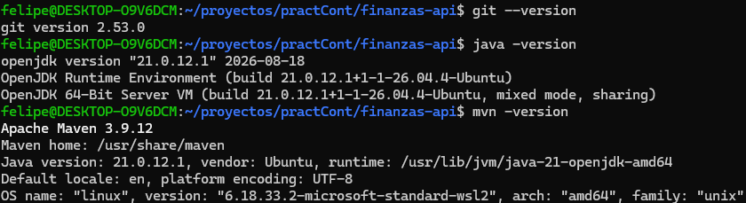


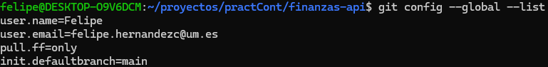

### Parte B — Generación de la API de finanzas

Se eligió el dominio de gastos e ingresos personales como alternativa a la API de tareas propuesta en el boletín. Con ayuda de ChatGPT se preparó un prompt que mantiene los requisitos de la práctica y los adapta a una entidad `FinancialTransaction`, con identificador, concepto, descripción, importe, tipo de movimiento y fecha. 

El diseño solicitado utiliza `BigDecimal` para los importes, distingue ingresos y gastos y contempla operaciones CRUD y cálculo del balance. También requiere separación por capas, persistencia con Spring Data JPA e H2 en memoria, validaciones y manejo de errores centralizado. Los tests solicitados son exclusivamente unitarios y deben comprobar reglas de negocio sin iniciar Spring ni una base de datos. Se tomó como referencia el ejemplo del boletín que especifica JPA/H2.

El commit `a51bc00` se identifica como la incorporación de la aplicación inicial.

#### Cumplimiento de los requisitos mínimos

El proyecto utiliza Spring Boot 3.5.16 y tiene configurado Java 21 en el `pom.xml`. La revisión del código permite relacionar los requisitos del boletín con los siguientes elementos concretos:

| Requisito | Implementación en el proyecto |
| --- | --- |
| Entidad de dominio con varios campos y validaciones | `FinancialTransaction` es una entidad JPA con `id`, `concept`, `description`, `amount`, `type` y `date`. Tanto la entidad como el DTO `TransactionRequest` incluyen restricciones de Bean Validation. |
| Persistencia con Spring Data JPA/Hibernate | `FinancialTransactionRepository` extiende `JpaRepository<FinancialTransaction, Long>`. La entidad se guarda en `financial_transactions` y el tipo de movimiento se persiste como texto mediante `EnumType.STRING`. |
| Base de datos H2 en memoria | `application.properties` configura `jdbc:h2:mem:finanzas` y `spring.jpa.hibernate.ddl-auto=create-drop`. Los datos no se conservan entre ejecuciones de la aplicación. |
| CRUD completo | `FinancialTransactionController` ofrece creación, listado, consulta por identificador, actualización y borrado bajo `/api/transactions`. La creación devuelve `201 Created` con cabecera `Location`; el borrado devuelve `204 No Content`. |
| Separación en capas | El controlador recibe las peticiones, `FinancialTransactionService` aplica las reglas de negocio y el repositorio gestiona la persistencia. `TransactionRequest`, `TransactionResponse` y `BalanceResponse` separan los datos de la API de la entidad JPA. |
| Manejo centralizado de errores | `GlobalExceptionHandler`, anotado con `@RestControllerAdvice`, transforma `TransactionNotFoundException` en `404 Not Found` y los errores de validación en `400 Bad Request`. El cuerpo `ApiError` incluye fecha, estado, error, mensaje, ruta y errores por campo, sin exponer la traza al cliente. |
| Al menos cinco tests de reglas de negocio | La versión final incluye 94 casos de prueba, con comprobaciones de valores, excepciones e interacciones. Entre ellos se verifican importes inválidos, fechas futuras, actualizaciones inválidas, recursos inexistentes y cálculo del balance. |
| Solo tests unitarios | Las clases se instancian directamente y las dependencias se simulan con Mockito. No se utilizan `@SpringBootTest`, `@DataJpaTest` ni `@WebMvcTest`, ni se inicia una base de datos. |
| JAR ejecutable con dependencias | El `pom.xml` incluye `spring-boot-maven-plugin`. El JAR aportado contiene las dependencias en `BOOT-INF/lib` y declara `JarLauncher` como clase principal y `FinanzasApiApplication` como clase de arranque. Se ejecuta con `java -jar target/finanzas-api-0.0.1-SNAPSHOT.jar`. |

Las validaciones exigen un concepto no vacío de hasta 100 caracteres, una descripción opcional de hasta 500, un importe positivo con un máximo de 12 dígitos enteros y 2 decimales, un tipo `INCOME` o `EXPENSE` y una fecha no futura. Se utilizan `@NotBlank`, `@Size`, `@NotNull`, `@DecimalMin`, `@Digits` y `@PastOrPresent`. El controlador activa la validación de las peticiones mediante `@Valid`.

El servicio también comprueba estas reglas al invocarse directamente. Para las fechas recibe un `Clock`, lo que permite fijar el día de referencia en los tests. En una actualización valida los datos antes de modificar la entidad existente, evitando que una petición inválida altere su estado. Los importes se representan con `BigDecimal` y se normalizan a dos decimales. El balance suma ingresos y resta gastos, devuelve cero cuando no hay movimientos y admite resultados negativos.

#### Tests implementados y resultados

La versión final entregada contiene cuatro clases de tests con JUnit 5. Los informes de Maven Surefire incluidos en `target/surefire-reports` registran la siguiente ejecución:

| Clase de test | Casos ejecutados | Qué comprueba |
| --- | ---: | --- |
| `FinancialTransactionServiceTest` | 52 | Validación al crear y actualizar, conservación de la entidad ante errores, operaciones con identificadores inexistentes, mapeo a DTOs, filtrado por fechas y balance. |
| `TransactionRequestValidationTest` | 17 | Restricciones de Bean Validation, campos inválidos, longitudes e importe máximos, fecha de hoy y descripción opcional. |
| `FinancialTransactionControllerTest` | 10 | Delegación al servicio, paso de los filtros, respuestas de creación y borrado, listado, consulta, actualización y balance. |
| `GlobalExceptionHandlerTest` | 15 | Respuestas 404, 400 y 500, estructura uniforme de errores, detalles por campo, parámetros y JSON inválidos, y ausencia de detalles técnicos en las respuestas de error. |
| **Total** | **94** | **0 fallos, 0 errores y 0 casos omitidos en los informes aportados.** |

El total cuenta las ejecuciones individuales de los tests parametrizados, no solo los métodos Java. Corresponde a la versión final del proyecto, que ya incluye la ampliación del filtrado por fechas; no implica que los 94 casos existieran en el primer commit.

Entre las comprobaciones de negocio destacan:

- Rechazar importes cero, negativos, con más de dos decimales o con más de doce dígitos enteros, sin guardar el movimiento.
- Rechazar fechas futuras y aceptar la fecha de hoy usando un reloj fijo.
- Rechazar datos inválidos en una actualización sin modificar los campos originales de la entidad ni llamar a `save`.
- Conservar el identificador al actualizar correctamente todos los campos editables.
- Lanzar `TransactionNotFoundException` al consultar, actualizar o borrar un identificador inexistente.
- Rechazar un intervalo de fechas invertido antes de consultar el repositorio y aceptar límites iguales para consultar un único día.
- Calcular el balance con decimales exactos, devolver totales cero sin movimientos y permitir que los gastos superen los ingresos.

Estas pruebas utilizan aserciones sobre valores concretos, `assertThrows` y verificaciones como `verifyNoInteractions` o `verify(..., never()).save(...)`. Por tanto, comprueban comportamiento y reglas reales, no únicamente que un objeto sea distinto de `null`.

Los tests de validación crean un `Validator` directamente y le proporcionan un reloj fijo. Los del controlador invocan sus métodos sin servidor HTTP, y los del manejador de errores construyen las excepciones y solicitudes simuladas necesarias. Usar utilidades de prueba de Spring no implica arrancar su contexto. Al simular el repositorio, las pruebas del filtro verifican qué consulta pide el servicio y cómo procesa su resultado, pero no ejecutan la consulta real contra H2.

Los resultados anteriores proceden de los informes incluidos en el proyecto. En esta revisión se inspeccionaron el código, los informes y la estructura del JAR; no se repitió `mvn package`, porque el entorno de revisión dispone de Java 17 y no tiene Maven instalado.

### Parte C — Construcción y comprobación local

La aplicación se construyó y probó en local. El procedimiento consistió en ejecutar `mvn clean package` para compilar, ejecutar los tests unitarios y generar el JAR ejecutable, y arrancarlo mediante `java -jar target/finanzas-api-0.0.1-SNAPSHOT.jar`. Después se comprobó la API creando un movimiento y consultándolo mediante peticiones HTTP. Además también se probó `mvn test` para comprobar los 94 casos de prueba.

Compilación, tests y empaquetado con Maven (`mvn clean package`):

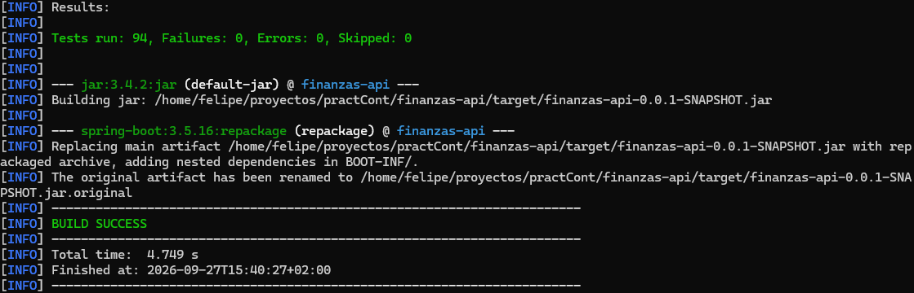


Arranque del JAR ejecutable(`java -jar target/finanzas-api-0.0.1-SNAPSHOT.jar`):

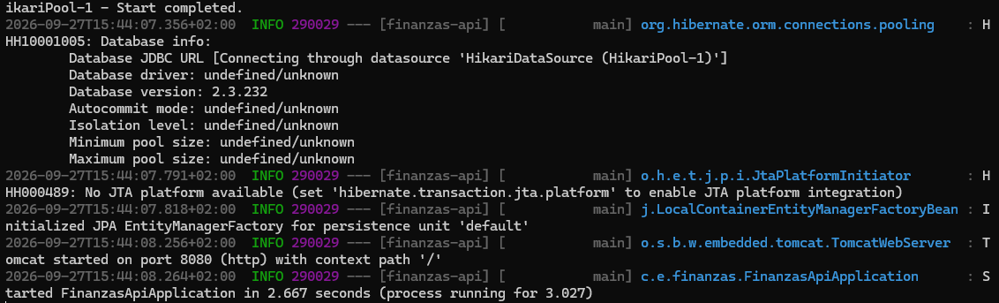


Creación y consulta de un movimiento mediante curl:

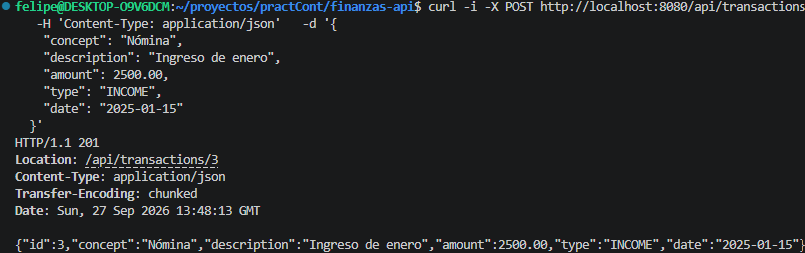

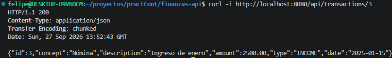

### Parte D — Historial y desarrollo en una rama

La base del proyecto y la configuración inicial de Git se registraron en `a51bc00`. A continuación, se añadió `.editorconfig` en un commit independiente, `b0515f6`, para compartir las preferencias de edición. Esta separación facilita distinguir la configuración de herramientas de los cambios funcionales.

Seguidamente se creó una nueva rama, `feat/filtro-fechas`, para implementar un pequeño cambio. Se eligió implementar el filtrado de movimientos por fechas, registrado en `bcac73d`. Esta funcionalidad permite consultar un periodo concreto y aporta utilidad a la API de finanzas. La implementación fue realizada por Codex, junto con los tests y tras comprobar que funcionaba se realizó un commit con los cambios realizados y se fusionó con la rama main.

#### Filtrar movimientos por fecha

El listado admite `from` y `to` en formato `AAAA-MM-DD`. Ambos límites son
inclusivos y los resultados conservan el orden ascendente por identificador.

| Parámetros | Movimientos devueltos |
| --- | --- |
| Ninguno | Todos los movimientos. |
| Solo `from` | Fecha igual o posterior a `from`. |
| Solo `to` | Fecha igual o anterior a `to`. |
| `from` y `to` | Fecha comprendida entre ambos extremos, incluidos. |

Si ambas fechas coinciden, se consultan los movimientos de ese día. Se pueden
utilizar límites futuros, por ejemplo el último día del mes en curso. Si no hay
coincidencias, se devuelve `[]` con estado `200 OK`.

Un intervalo invertido devuelve `400 Bad Request` con el mensaje
`La fecha 'from' no puede ser posterior a 'to'.` y un detalle en
`fieldErrors.from`. Las fechas con formato inválido también devuelven `400`, con
un detalle sobre el parámetro afectado.

```bash
# Todos los movimientos
curl -i 'http://localhost:8080/api/transactions'

# Movimientos de septiembre de 2026
curl -i 'http://localhost:8080/api/transactions?from=2026-09-01&to=2026-09-30'

# Desde el 1 de septiembre, incluido
curl -i 'http://localhost:8080/api/transactions?from=2026-09-01'

# Hasta el 30 de septiembre, incluido
curl -i 'http://localhost:8080/api/transactions?to=2026-09-30'

# Intervalo invertido: 400 Bad Request
curl -i 'http://localhost:8080/api/transactions?from=2026-09-30&to=2026-09-01'

```

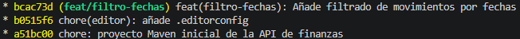


### Parte E — Spotless y hook de pre-commit

En `b61eeaa` se añadió Spotless al `pom.xml` y se probaron los modos de comprobación y aplicación del formato. El objetivo es mantener un estilo Java uniforme y evitar diferencias debidas únicamente a decisiones manuales de formato.

El plugin, el script `.githooks/pre-commit` y el reformateo de Java quedaron incorporados en `b61eeaa`. El commit posterior `5ec39ed` fue un commit vacío de prueba: su árbol coincide con el de su padre. El script se guarda en `.githooks/pre-commit` para que pueda versionarse. La activación mediante `git config core.hooksPath .githooks` es una configuración local: cada persona debe ejecutarla en su copia del repositorio y el README debe explicarlo.

El hook trabajado ejecuta `mvn -q spotless:apply` antes del commit y cancela la operación si el comando falla. Después utiliza `git add -u`, que incorpora al índice todos los cambios de archivos ya versionados, no únicamente los cambios de formato. Por ello, hay que revisar qué modificaciones están pendientes antes de confirmar. El hook tampoco sustituye una comprobación en CI, ya que puede omitirse con `--no-verify`.

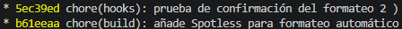

Las capturas de terminal pueden complementar el historial mostrando el mensaje `Formatting with Spotless...` durante la ejecución del hook.


### Parte F — Conflicto y resolución manual

Para practicar los conflictos se modificó el título de `README.md` de dos formas distintas. La rama `refactor/conflicto_1` recoge el cambio a finanzas personales en `c1f5f5a`, y `refactor/conflicto_2` recoge el cambio a gestión de ingresos y gastos en `1bdbebc`.

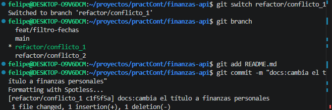

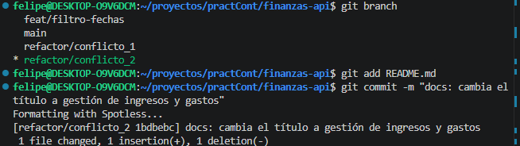

La secuencia del ejercicio consiste en crear ambas ramas desde el mismo punto de `main`, integrar primero una y después intentar integrar la otra. Git no puede elegir automáticamente entre las dos modificaciones incompatibles y señala el conflicto. La resolución manual consiste en editar el bloque delimitado por `<<<<<<<`, `=======` y `>>>>>>>`, eliminar los marcadores y conservar el título definitivo.

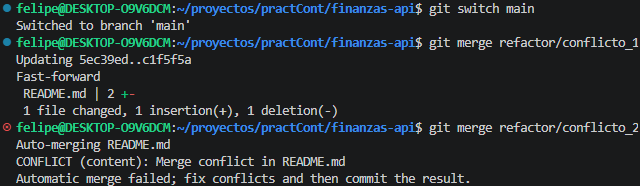

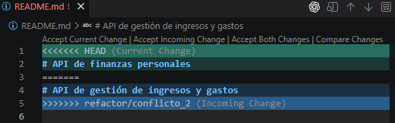


Tras guardar el README, se añade al índice con `git add` y se termina la fusión con `git commit`.


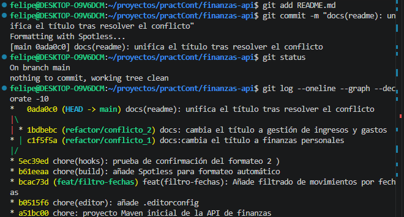

 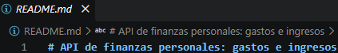
