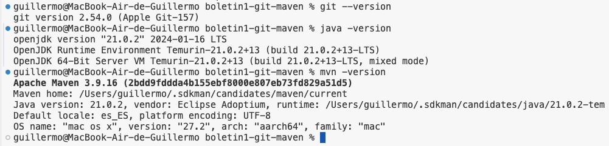
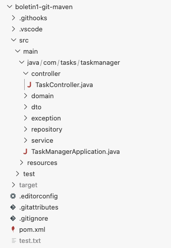
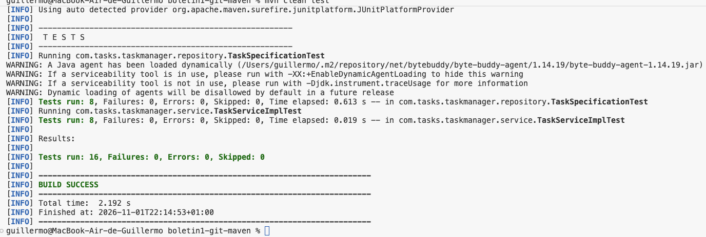
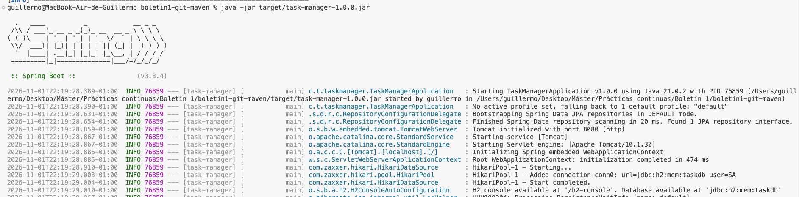
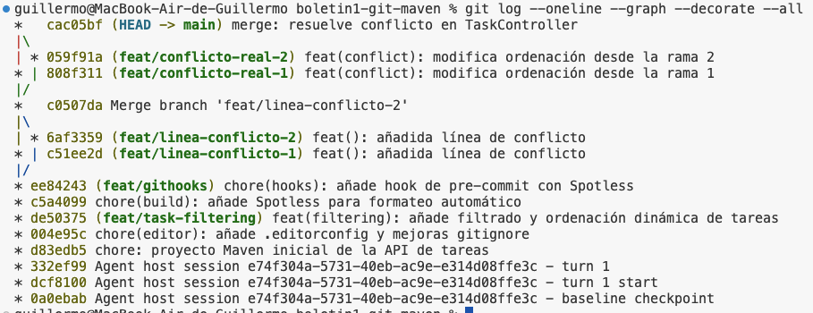
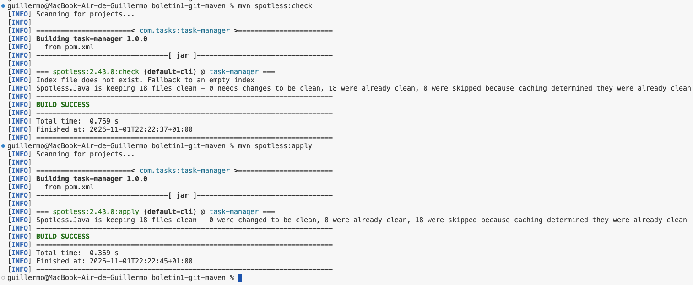

# Boletín 1 — Git y proyecto Maven

## Resumen de commits

El boletín se realizó en un repositorio individual. Por tanto, los hashes y las
ramas que aparecen a continuación corresponden a un repositorio distinto al actual.

| # | Mensaje del commit | Qué se hizo | Rama | Commit |
|---|---|---|---|---|
| 1 | `chore: proyecto Maven inicial de la API de tareas` | Se creó la API REST de tareas con Spring Boot, Maven, Java 21, JPA/H2 y tests unitarios. | `main` | `d83edb5` |
| 2 | `chore(editor): añade .editorconfig y mejoras gitignore` | Se añadieron `.editorconfig` y mejoras al `.gitignore`. | `main` | `004e95c` |
| 3 | `feat(filtering): añade filtrado y ordenación dinámica de tareas` | Se incorporaron filtros, ordenación dinámica y tests asociados. | `feat/task-filtering` | `de50375` |
| 4 | `chore(build): añade Spotless para formateo automático` | Se configuró Spotless con Google Java Format. | `main` | `c5a4099` |
| 5 | `chore(hooks): añade hook de pre-commit con Spotless` | Se añadió un hook versionado para aplicar Spotless antes de cada commit. | `feat/githooks` | `ee84243` |
| 6 | `feat(): añadida línea de conflicto` | Primera modificación de la misma zona del controlador para preparar el conflicto. | `feat/linea-conflicto-1` | `c51ee2d` |
| 7 | `feat(): añadida línea de conflicto` | Segunda modificación incompatible en la misma zona del controlador. | `feat/linea-conflicto-2` | `6af3359` |
| 8 | `Merge branch 'feat/linea-conflicto-2'` | Se integraron las ramas originales; Git resolvió automáticamente sus cambios porque afectaban a líneas distintas. | `main` | `c0507da` |
| 9 | `feat(conflict): modifica ordenación desde la rama 1` | Se modificó deliberadamente la misma línea que en la rama 2 para provocar un conflicto real. | `feat/conflicto-real-1` | `808f311` |
| 10 | `feat(conflict): modifica ordenación desde la rama 2` | Segunda modificación incompatible de la misma línea de `TaskController.java`. | `feat/conflicto-real-2` | `059f91a` |
| 11 | `merge: resuelve conflicto en TaskController` | Se resolvieron los marcadores del conflicto y se comprobó el proyecto con Maven. | `main` | `cac05bf` |

## Detalle por commit

### 1. `chore: proyecto Maven inicial de la API de tareas` — `d83edb5`

- **Qué se hizo:** se creó la API REST de gestión de tareas con Spring Boot
  3.3.4, Java 21 y Maven.
- **Aplicación:** se implementó una entidad `Task` con título, descripción,
  estado, prioridad y fecha límite.
- **Persistencia:** se utilizó Spring Data JPA con H2 en memoria.
- **Arquitectura:** se separaron las capas de controlador, servicio y
  repositorio.
- **Calidad:** se añadieron validaciones, manejo centralizado de errores y
  tests unitarios con JUnit 5 y Mockito.
- **Relación con el boletín:** partes B y C.

### 2. `chore(editor): añade .editorconfig y mejoras gitignore` — `004e95c`

- **Qué se hizo:** se añadió `.editorconfig` y se mejoró `.gitignore`.
- **Configuración:** se normalizaron UTF-8, finales de línea LF, salto final e
  indentación.
- **Relación con el boletín:** parte D.

### 3. `feat(filtering): añade filtrado y ordenación dinámica de tareas` — `de50375`

- **Qué se hizo:** se añadió una funcionalidad no trivial en la rama
  `feat/task-filtering`.
- **Funcionalidad:** `GET /api/v1/tasks` admite filtros por estado, prioridad y
  fechas, además de ordenación dinámica.
- **Implementación:** se incorporaron `TaskFilterParams`, `TaskSpecification`,
  `JpaSpecificationExecutor<Task>` y ocho tests específicos.
- **Relación con el boletín:** parte D.

### 4. `chore(build): añade Spotless para formateo automático` — `c5a4099`

- **Qué se hizo:** se configuró el plugin Spotless versión `2.43.0`.
- **Configuración:** Google Java Format, imports no utilizados, espacios finales
  y salto de línea final.
- **Relación con el boletín:** parte E.

### 5. `chore(hooks): añade hook de pre-commit con Spotless` — `ee84243`

- **Qué se hizo:** se añadió `.githooks/pre-commit` y se configuró
  `core.hooksPath`.
- **Comportamiento:** antes de cada commit se ejecuta
  `mvn -q spotless:apply` y se vuelven a añadir los archivos reformateados.
- **Relación con el boletín:** parte E.

### 6–7. Preparación inicial del conflicto — `c51ee2d` y `6af3359`

- **Qué se hizo:** se modificó la misma zona de `TaskController.java` desde las
  ramas `feat/linea-conflicto-1` y `feat/linea-conflicto-2`.
- **Resultado:** ambas ramas quedaron preparadas para ser integradas.
- **Observación:** sus cambios afectaban a líneas distintas, por lo que Git
  pudo resolver automáticamente ese primer merge en `c0507da`.
- **Relación con el boletín:** parte F.

### 8. `Merge branch 'feat/linea-conflicto-2'` — `c0507da`

- **Qué se hizo:** se integraron las ramas iniciales de conflicto en `main`.
- **Resultado:** el merge fue automático porque no modificaban exactamente la
  misma línea.
- **Relación con el boletín:** preparación de la parte F.

### 9–10. Conflicto real — `808f311` y `059f91a`

- **Qué se hizo:** se crearon `feat/conflicto-real-1` y
  `feat/conflicto-real-2`.
- **Cambio:** ambas ramas modificaron de forma distinta la línea
  `params.setSortDir(sortDir);`.
- **Resultado:** el segundo merge produjo un conflicto de contenido real.
- **Relación con el boletín:** parte F.

### 11. `merge: resuelve conflicto en TaskController` — `cac05bf`

- **Qué se hizo:** se eliminaron manualmente los marcadores del conflicto y se
  conservó una única instrucción válida.
- **Comprobación:** se ejecutó `mvn clean test` y el merge quedó registrado en
  `main`.
- **Relación con el boletín:** resolución completa de la parte F.

## Resultados de las comprobaciones

En el repositorio original `boletin1-git-maven` se verificó:

```text
mvn clean test       -> BUILD SUCCESS
mvn spotless:check   -> BUILD SUCCESS
mvn clean package    -> BUILD SUCCESS
```

El proyecto contiene 16 tests unitarios y genera el artefacto ejecutable
`target/task-manager-1.0.0.jar`.


### Parte A — Instalación y verificación del entorno

Se comprobó que el entorno tenía Git, Java 21 y Maven instalados:

```bash
git --version
java -version
mvn -version
```

También se configuró la identidad de Git y la política de ramas recomendada:

```bash
git config --global user.name "Guillermo López Fuentes"
git config --global user.email "guillermo.lopezf@um.es"
git config --global pull.ff only
git config --global init.defaultBranch main
```

#### Evidencia




### Parte B — Generar la aplicación con ayuda de IA

Se creó una API REST de gestión de tareas con Spring Boot 3.3.4, Java 21 y
Maven. El proyecto utiliza Spring Data JPA y H2 en memoria, por lo que no
requiere una base de datos externa.

La estructura principal es:

```text
src/
├── main/java/com/tasks/taskmanager/
│   ├── TaskManagerApplication.java
│   ├── controller/TaskController.java
│   ├── domain/
│   │   ├── Task.java
│   │   ├── TaskPriority.java
│   │   └── TaskStatus.java
│   ├── dto/
│   │   ├── TaskFilterParams.java
│   │   ├── TaskRequest.java
│   │   └── TaskResponse.java
│   ├── exception/
│   │   ├── ErrorResponse.java
│   │   ├── GlobalExceptionHandler.java
│   │   ├── InvalidTaskStateException.java
│   │   └── TaskNotFoundException.java
│   ├── repository/
│   │   ├── TaskRepository.java
│   │   └── TaskSpecification.java
│   └── service/
│       ├── TaskService.java
│       └── TaskServiceImpl.java
└── test/java/com/tasks/taskmanager/
    ├── repository/TaskSpecificationTest.java
    └── service/TaskServiceImplTest.java
```

La entidad `Task` contiene identificador, título, descripción, estado,
prioridad y fecha límite. Se aplican validaciones con Jakarta Bean Validation,
incluyendo título obligatorio, estado y prioridad obligatorios y fecha futura.

La aplicación cumple los requisitos principales del enunciado:

- operaciones de creación, consulta, actualización y borrado;
- separación en controlador, servicio y repositorio;
- persistencia con JPA/H2;
- respuestas centralizadas para errores, incluido `404` cuando no existe una
  tarea;
- tests unitarios con JUnit 5 y Mockito, sin levantar el contexto de Spring;
- generación de un JAR ejecutable mediante Maven.

El primer commit que contiene esta aplicación es `d83edb5`.

#### Evidencia




### Parte C — Construir y probar en local

Se construyó el proyecto y se ejecutaron los tests unitarios:

```bash
mvn clean test
```

Después se generó el JAR ejecutable:

```bash
mvn clean package
```

El artefacto generado es:

```text
target/task-manager-1.0.0.jar
```

Para arrancar la API, primero hay que situarse en la raíz del repositorio
original y generar el JAR:

```bash
cd "../Boletín 1/boletin1-git-maven"
mvn clean package
java -jar target/task-manager-1.0.0.jar
```

Si el repositorio se encuentra en otra ubicación, sustituye la ruta del
comando `cd` por la ruta local correspondiente. El JAR no existe hasta
ejecutar `mvn clean package`.

La aplicación escucha en el puerto `8080`. Los endpoints utilizan la ruta base
`/api/v1/tasks`.

Ejemplo de creación:

```bash
curl -X POST http://localhost:8080/api/v1/tasks \
  -H "Content-Type: application/json" \
  -d '{"title":"Comprar leche","description":"Pasar por el supermercado","status":"PENDING","priority":"HIGH","dueDate":"2099-12-31"}'
```

Ejemplo de consulta:

```bash
curl http://localhost:8080/api/v1/tasks/1
```

También se pueden probar la actualización, el borrado, la búsqueda por texto y
los filtros por estado/prioridad/fecha con ordenación dinámica.

#### Evidencias






### Parte D — Control de versiones con Git

#### D.1. Commit inicial

Se creó el repositorio Maven y se incorporaron la aplicación y la configuración
base de Git:

```bash
git init
git add .
git commit -m "chore: proyecto Maven inicial de la API de tareas"
```

Este commit es `d83edb5`.

#### D.2. Configuración del editor

En el commit `004e95c` se añadió `.editorconfig` y se mejoró `.gitignore`.
La configuración establece codificación UTF-8, finales de línea LF, salto final
de línea e indentación coherente.

```bash
git add .editorconfig .gitignore
git commit -m "chore(editor): añade .editorconfig y mejoras gitignore"
```

#### D.3. Desarrollo de una funcionalidad en una rama

Se creó la rama `feat/task-filtering`:

```bash
git switch -c feat/task-filtering
```

En ella se añadió filtrado y ordenación dinámica en `GET /api/v1/tasks`.
Los parámetros disponibles son `status`, `priority`, `dueBefore`, `dueAfter`,
`sortBy` y `sortDir`.

La implementación utiliza `TaskSpecification` y
`JpaSpecificationExecutor<Task>`. También se añadieron ocho tests unitarios
específicos para los filtros y la ordenación.

El cambio quedó registrado en `de50375`.

#### D.4. Historial

Para revisar el grafo y las ramas se utilizaron:

```bash
git log --oneline --graph --decorate --all
git branch --all
```

#### Evidencias




### Parte E — Formateo automático en cada commit

#### E.1. Configuración de Spotless

En `pom.xml` se añadió `spotless-maven-plugin` versión `2.43.0`, configurado
con Google Java Format, eliminación de imports no utilizados, eliminación de
espacios finales y salto de línea final.

Se comprobaron los dos modos:

```bash
mvn spotless:check
mvn spotless:apply
```

El commit correspondiente es `c5a4099`.

#### E.2. Hook de pre-commit

Se creó `.githooks/pre-commit` con el siguiente contenido:

```sh
#!/bin/sh
echo "Formatting with Spotless..."
mvn -q spotless:apply || exit 1
git add -u
```

El hook se activa para el repositorio mediante:

```bash
chmod +x .githooks/pre-commit
git config core.hooksPath .githooks
```

Su objetivo es aplicar el formato automáticamente antes de crear cada commit
y volver a añadir los archivos modificados por Spotless. El commit del hook es
`ee84243`.

#### Evidencias




### Parte F — Provocar y resolver un conflicto

Primero se integraron las ramas originales `feat/linea-conflicto-1` y
`feat/linea-conflicto-2`. Aunque ambas modificaban la misma zona del archivo,
Git pudo resolver automáticamente el merge porque las líneas exactas no
coincidían. Ese merge quedó registrado en `c0507da`.

Para cumplir exactamente el requisito del enunciado, se crearon dos ramas
adicionales desde `main` que modificaron deliberadamente la misma línea:

```bash
git switch -c feat/conflicto-real-1
git switch main
git switch -c feat/conflicto-real-2
```

En `feat/conflicto-real-1` se cambió la línea de ordenación:

```java
params.setSortDir(sortDir); // configuración de la rama 1
```

El cambio quedó registrado en `808f311`. En la segunda rama se modificó la
misma línea de otra forma:

```java
params.setSortDir(sortDir); // configuración de la rama 2
```

Este cambio quedó registrado en `059f91a`.

Después se integró la primera rama y se intentó integrar la segunda:

```bash
git switch main
git merge feat/conflicto-real-1
git merge feat/conflicto-real-2
```

El segundo merge produjo el conflicto:

```text
Auto-merging src/main/java/com/tasks/taskmanager/controller/TaskController.java
CONFLICT (content): Merge conflict in src/main/java/com/tasks/taskmanager/controller/TaskController.java
Automatic merge failed; fix conflicts and then commit the result.
```

Git marcó las dos versiones:

```java
<<<<<<< HEAD
params.setSortDir(sortDir); // configuración de la rama 1
=======
params.setSortDir(sortDir); // configuración de la rama 2
>>>>>>> feat/conflicto-real-2
```

La resolución manual consistió en eliminar los marcadores y conservar la
instrucción sin comentarios:

```java
params.setSortDir(sortDir);
```

Finalmente se añadió el archivo resuelto, se ejecutaron los tests y se creó el
merge:

```bash
git add src/main/java/com/tasks/taskmanager/controller/TaskController.java
mvn clean test
git commit -m "merge: resuelve conflicto en TaskController"
```

El commit de resolución es `cac05bf`. La salida final del historial muestra el
merge y sus dos padres:

```text
*   cac05bf (HEAD -> main) merge: resuelve conflicto en TaskController
|\
| * 059f91a (feat/conflicto-real-2) feat(conflict): modifica ordenación desde la rama 2
* | 808f311 (feat/conflicto-real-1) feat(conflict): modifica ordenación desde la rama 1
|/
* c0507da Merge branch 'feat/linea-conflicto-2'
```


