# Boletín 2

## Resumen de commits

| # | Mensaje del commit | Qué se hizo | Autor | Enlace |
|---|--------------------|-------------|-------|--------|
| 1 | `chore: añade plantillas y normas de colaboración`        | ...         | Felipe   | [enlace](https://github.com/AntonioUMU/practicas-continuas/commit/7422f6198a351a5f635023b6a7a807eaaa0a0991) |
| 2 | `feat(books): permite buscar libros por título`        | ...         | Felipe   | [enlace](https://github.com/AntonioUMU/practicas-continuas/commit/98ac37681149846c7095e8d3807e6654e767b6f4) |
| 3 | `chore(conflict): cambia el parámetro del constructor de BookService`        | ...         | Felipe   | [enlace](https://github.com/AntonioUMU/practicas-continuas/commit/95356cf6e9edebe1952c29a3e206c4e118ffb31d) |
| 4 | `feat(books): añade paginación al listado de libros`        | ...         | Antonio   | [enlace](https://github.com/AntonioUMU/practicas-continuas/commit/6d10e01e9d9523bcd1f84bcb5433dc57adca5a67) |
| 5 | `Merge pull request #4 from AntonioUMU/feat/2-busqueda-por-titulo`        | ...         | Felipe   | [enlace](https://github.com/AntonioUMU/practicas-continuas/commit/55aa75367fa2f5cae5b54e35e7ac1b7507ee43bc) |
| 6 | `Merge pull request #5 from AntonioUMU/feat/paginacion`        | ...         | Antonio   | [enlace](https://github.com/AntonioUMU/practicas-continuas/commit/4c4f5ee735e87fcd1e0e793a96f05d0e99e332c9) |

## Detalle por commit

### 1. `chore: añade plantillas y normas de colaboración`
- **Qué se hizo:** Añade un archivo con los CODEOWNERS, plantillas para crear los Pull Request e Issues y el archivo CONTRIBUTING con las normas de colaboración.
- **Autor:** Felipe
- **Relación con el boletín:** Parte B
- **Uso de IA:** sí, ChatGPT para generar las plantillas y el fichero con las normas de colaboración.

### 2. `feat(books): permite buscar libros por título`
- **Qué se hizo:** Implementar la búsqueda opcional por título.
- **Autor:** Felipe
- **Relación con el boletín:** Parte D
- **Uso de IA:** sí, CODEX para implementar el código.

### 3. `feat(books): añade paginación al listado de libros`
- **Qué se hizo:** Implementar la paginación para consultar los limbros por páginas y limitar el número de resultados devueltos.
- **Autor:** Antonio
- **Relación con el boletín:** Parte D
- **Uso de IA:** Cambio y código propuesto por ChatGPT, el código ha sido implementado manualmente comprobando que supera los tests. 

### 4. `chore(conflict): cambia el parámetro del constructor de BookService`
- **Qué se hizo:** Resolver conflicto.
- **Autor:** Felipe
- **Relación con el boletín:** Parte E
- **Uso de IA:** No se ha usado. 

### 5. `Merge pull request #4 from AntonioUMU/feat/2-busqueda-por-titulo`
- **Qué se hizo:** Fusionar el pull request con la rama `main`.
- **Autor:** Felipe
- **Relación con el boletín:** Parte D
- **Uso de IA:** No se ha usado. 

### 6. `Merge pull request #5 from AntonioUMU/feat/paginacion`
- **Qué se hizo:** Fusionar el pull request con la rama `main`.
- **Autor:** Antonio
- **Relación con el boletín:** Parte D
- **Uso de IA:** No se ha usado. 

## Descripción narrativa de lo hecho en la sesión y relación con los commits

### Parte A

- Se creó un nuevo repositorio público en GitHub bajo la cuenta de Antonio en el siguiente [enlace](https://github.com/AntonioUMU/practicas-continuas/).

- Se configuró de forma completamente vacía (sin inicializar con archivos README.md, .gitignore o licencias) para evitar conflictos de historial con el push inicial.

- Se envió e invitó a Felipe al repositorio como colaborador, otorgándole los permisos necesarios para realizar acciones de push directamente sobre las ramas del repositorio remoto.

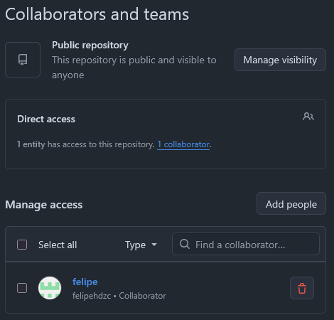

- Se redactó y completó el archivo `README.md` en la raíz del proyecto para garantizar que cualquier desarrollador pueda poner la aplicación en marcha desde cero.

### Parte B
Lo primero que realizamos en esta parte fue configurar la plantilla para los Pull Requests en `.github/PULL_REQUEST_TEMPLATE.md`.

Seguidamente, en el directorio `.github/` creamos el directorio `ISSUE_TEMPLATE` y, dentro de este, creamos las plantillas y etiquetas para bugs (`bug`) y mejoras (`enhancement`). A continuación podemos ver el contenido de los ficheros `bug.md`y `enhancement.md` respectivamente:

**_bug.md_**:
```
---
name: "Error"
about: "Comunicar un fallo de la API"
title: "[BUG] "
labels: bug
---

## Descripción del error

## Pasos para reproducirlo

1.
2.
3.

## Resultado esperado

## Resultado obtenido

## Entorno

- Sistema operativo:
- Versión de Java:

```
**_enhancement.md_**:
```
---
name: "Mejora"
about: "Proponer una funcionalidad o mejora de la API"
title: "[MEJORA] "
labels: enhancement
---

## Necesidad

¿Qué problema queremos resolver?

## Propuesta

¿Cómo debería funcionar la mejora?

## Criterios de aceptación

- [ ]
- [ ]

```

Las plantillas y etiquetas de Issue en GitHub son herramientas esenciales para organizar, estandarizar y automatizar el seguimiento de tareas, errores o mejoras dentro de un repositorio.

A continuación, creamos el archivo `.github/CODEOWNERS` para definir los propietarios del código, de forma que Github solicite automáticamente la revisión de los PR a los usuarios definidos en dicho fichero.

``` 
# Toda la aplicación la revisa el equipo
*               @AntonioUMU @felipehdzc
```
El * abarca todos los archivos. Al abrir un PR contra main, GitHub usará el `CODEOWNERS` de esa rama para solicitar una revisión; cuando configuremos la protección de main, podremos exigir la aprobación de un propietario. Basta con la aprobación de uno de los propietarios indicados.

Para seleccionar la política de fusión debemos irnos a `Settings → General → Pull Requests` y una vez allí activamos o desactivamos las opciones (`Squash merging, Merge commits o Rebase merging`) en función de nuestras preferencias. En nuestro caso, la estrategia de fusión del Pull Request elegida ha sido `merge commits`.

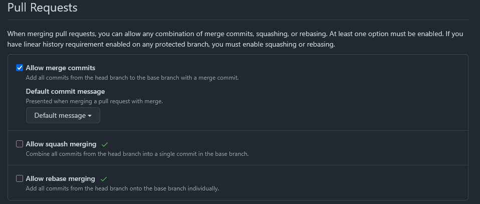

Por último, generamos el fichero [CONTRIBUTING.md](imagenes/boletin2-felipe/CONTRIBUTING.md) con las instrucciones para aquellas personas que quieran contribuir en el proyecto.

Tras realizar todos estos cambios procedemos a realizar el correspondiente commit y el consecutivo push de los ficheros modificados y añadidos.

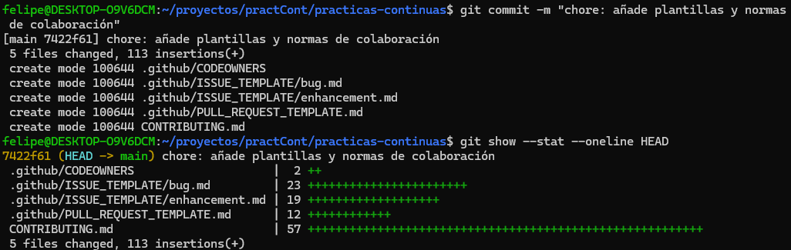

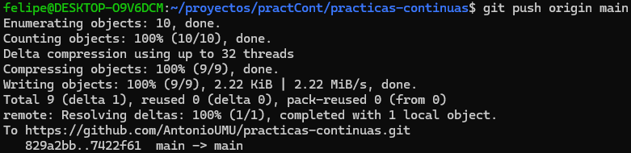

Tras hacer el push podemos irnos a nuestro repositorio y en el apartado `Issues`, podemos crear una nueva Issue y ver que se reconocen correctamente las plantillas que hemos añadido.
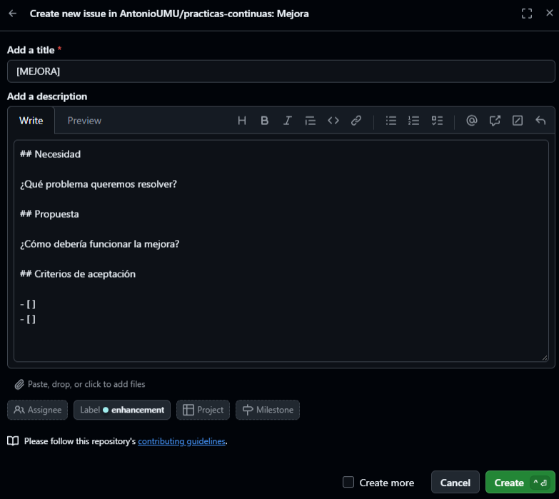

También podemos ver como se identifican correctamente los `code owners`que hemos definido.
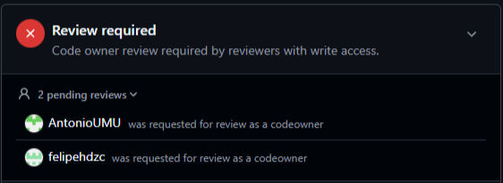

### Parte C

En esta parte se configuran las reglas de protección de la rama `main` para evitar que cualquier persona ajena al proyecto pueda realizar cambios directos.

- *Require a pull request before merging*: impide que nadie suba código directamente a la rama `main`. Cualquier cambio debe proponerse a través de un Pull Request (PR).
- *Require at least 1 approval*: asegura que otra persona revise el código.
- *Require review from Code Owners*: obliga que los responsables de esa parte, definidos en el archivo `CODEOWNERS`, aprueben el Pull Request.

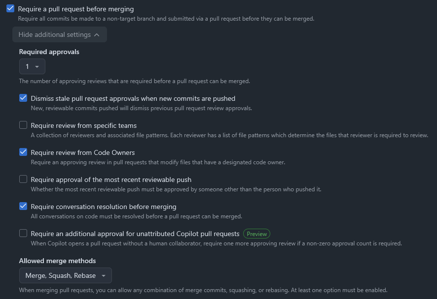

Tras proteger la rama `main`, en local se añade un archivo y se hace un commit sin problemas. Al realizar el `git push` es rechazado como se puede comprobar en la siguiente captura:

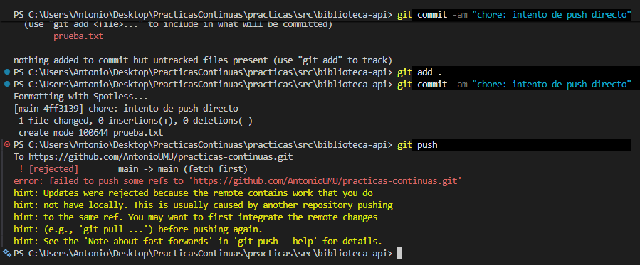


### Parte D
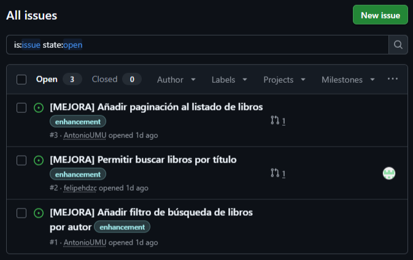

##### Issue #2 - Propuesto por Felipe y revisado por Antonio.

El Issue propone una mejora para realizar búsqueda opcional por título. La búsqueda admite coincidencias parciales sin distinguir mayúsculas y minúsculas. Si se omite title o solo contiene espacios, el endpoint sigue devolviendo todos los libros.

- El primer paso fué crear el Issue con la etiqueta de `enhancement` y utilizando la plantilla de la parte B.

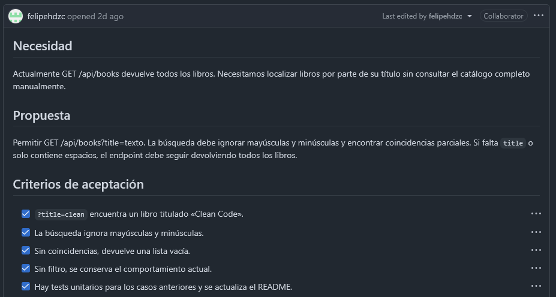

- En una nueva rama llamada `feat/2-busqueda-por-titulo` se implementa la funcionalidad del Issue y se crea el commit correspondiente al número 2 de la tabla principal de commits, también se puede consultar en el siguiente [enlace](https://github.com/AntonioUMU/practicas-continuas/commit/98ac37681149846c7095e8d3807e6654e767b6f4).

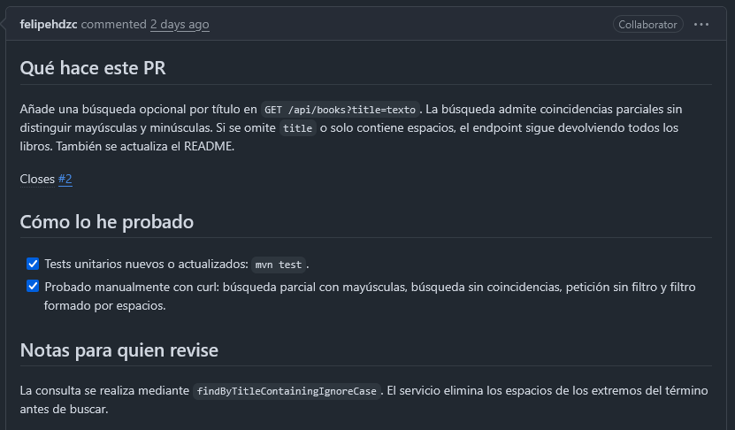

- Después se sube la rama al repositorio con `git push -u origin feat/2-busqueda-por-titulo` y se creó el Pull Request enlazado con el Issue #2 creado anteriormente.

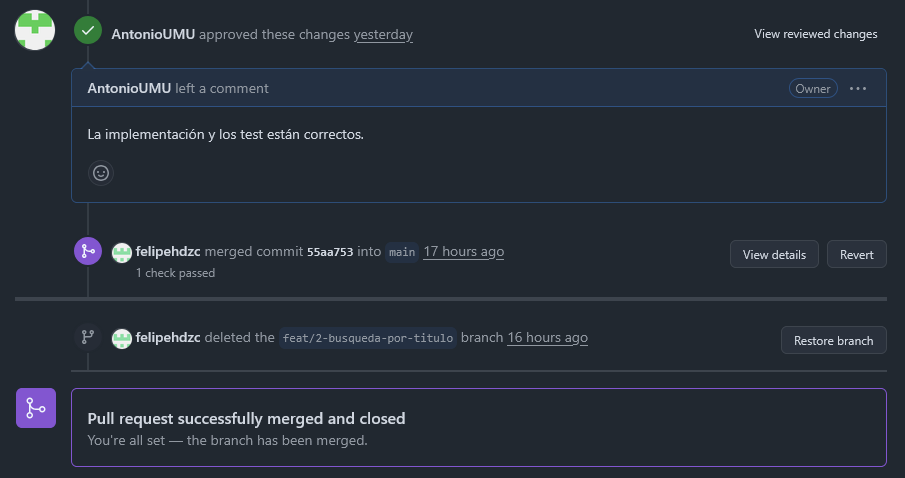

- Por último, el Pull Request es revisado por Antonio y la rama se fusiona con el `main`, cerrando el Issue y el Pull Request.

##### Issue #3 - Propuesto por Antonio y revisado por Felipe.

El siguiente Issue propone una mejora a la aplicación para que soporte a la paginación para consultar los libros por páginas y limitar el número de resultados devueltos. 

- El primer paso fué crear el Issue con la etiqueta de `enhancement` y utilizando la plantilla de la parte B.

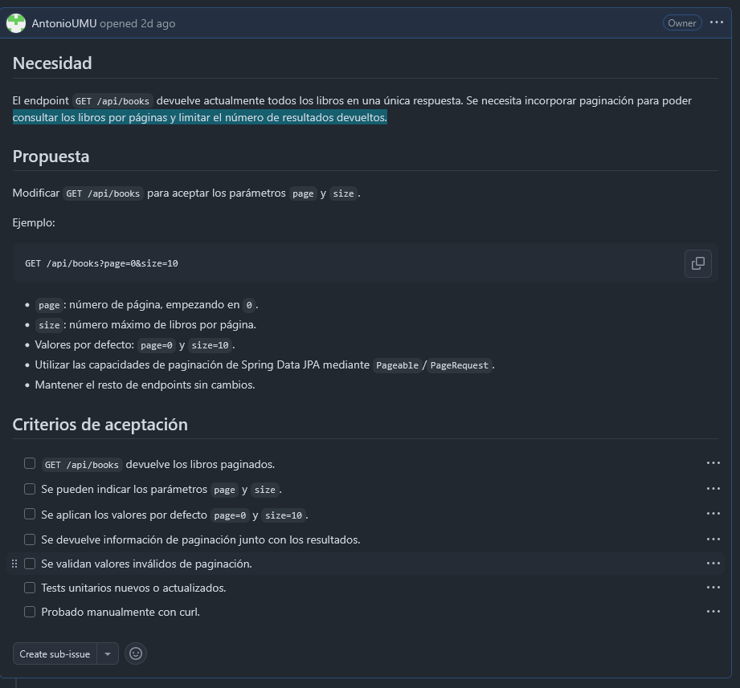

- El siguiente paso fué implementar la mejora en una nueva rama en local llamada `feat/paginacion`. El commit correspondiente a la implementación es el número 3 de la tabla principal de commits o se puede consultar a través del siguiente  [enlace](https://github.com/AntonioUMU/practicas-continuas/commit/6d10e01e9d9523bcd1f84bcb5433dc57adca5a67).

- Tras subir la rama al repositorio con `git push -u origin feat/paginacion`, se creó el Pull Request enlazado con el Issue #3 creado anteriormente:

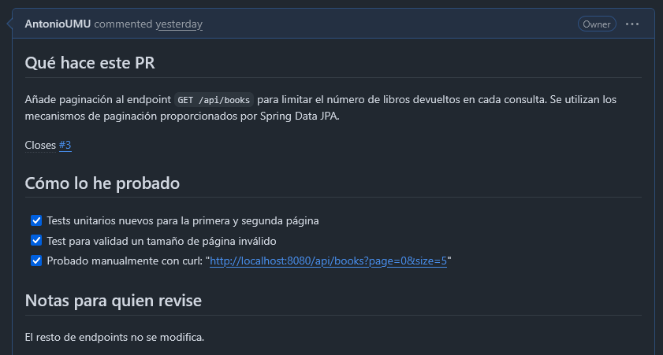

- Finalmente, al revisar el Pull Request (Felipe) apareció un conflicto debido a que ambos integrantes modificamos el fichero de tests.

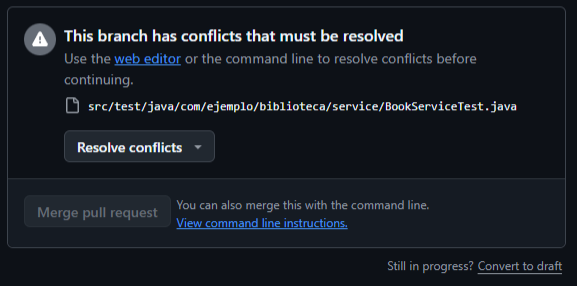

Para resolver el conflicto se aceptaron los cambios realizados por ambos integrantes (**_`Accept Both Changes`_**)y la rama se fusionó automáticamente con el `main`, cerrando el Issue y el Pull Request.

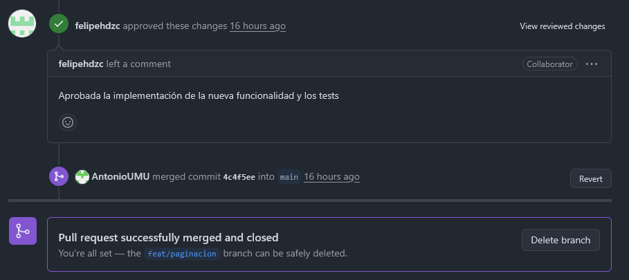

### Parte E

En este apartado, ambos miembros modificarón el mismo código para provocar un conflicto en el Pull Request. El código se encuentra en la clase `BookService.java` y los dos cambian el nombre del parámetro de entrada en el constructor.

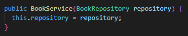

- Antonio realiza el primer cambio del código en su rama y se fusiona correctamente vía Pull Request.

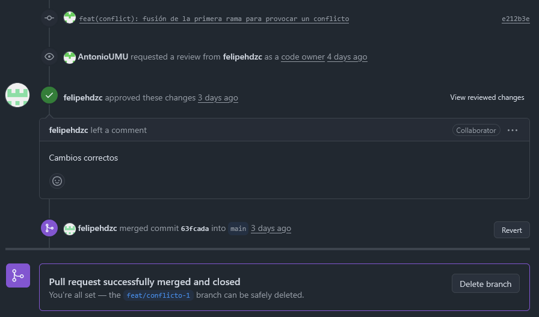

- Cuando Felipe hizo su cambio en la rama (`feat/conflicto-2`) y generó el Pull Request, apareció un mensaje de que había un conflicto debido a que ambos integrantes modificamos la misma línea de código.

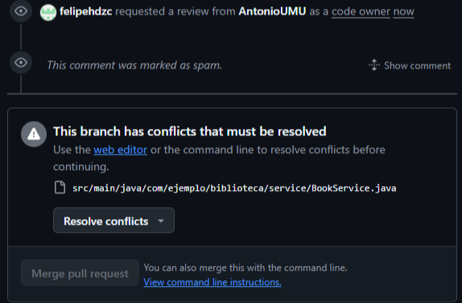


- Al intentar hacer el PR podíamos observar la línea que generaba el conflicto:
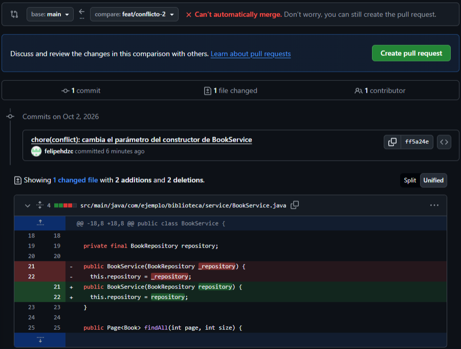

- Para resolver el conflicto se realizó un `git rebase`y se eliminó una de las líneas que generaba el conflicto en VScode:
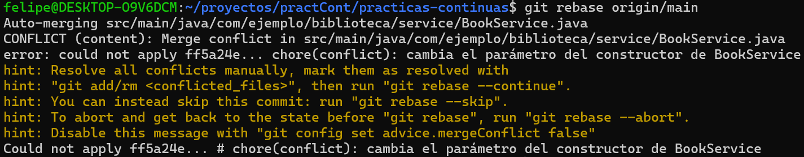
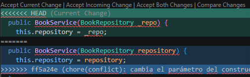
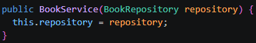

- A continuación se terminó el **`rebase`** satisfactoriamente y se realizó un **`push`** de los cambios realizados utilizando `--force-with-lease`para sobrescribir el historial remoto de la rama:
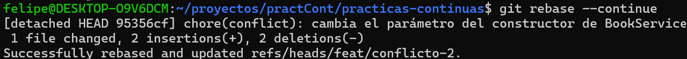
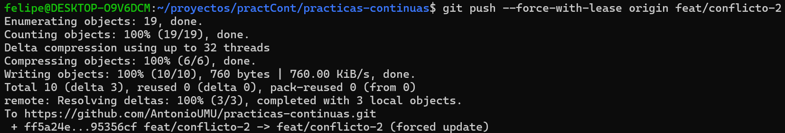

- Ahora si volvemos al PR ya no aparece el mensaje de antes y aparece el mensaje de solicitud de revisión: 
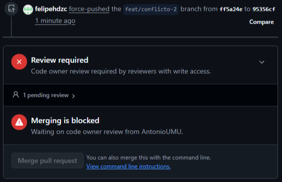

- Por último, tras Antonio aprobar los cambios se fusiona la rama correctamente:

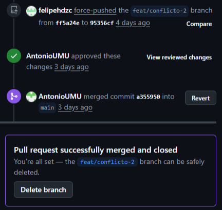


### Parte F

- En esta parte se busca resolver el [Issue #1](https://github.com/david30520/boletines-pc/issues/1) del repositorio de otro grupo de prácticas. Este Issue consiste en permitir la búsqueda de tareas por prioridad mediante el parámetro opcional `priority` en cuyos valores admitidos son LOW, MEDIUM y HIGH, correspondientes al enum TaskPriority existente.

- Felipe realiza un fork del repositorio `https://github.com/david30520/boletines-pc` y crea una rama `feat/filtrado-prioridad`. Después implementa las funciones necesarias y realiza el commit y push.

- Antonio clona el repositorio y crea una rama `test/filtrado-prioridad` a partir de la rama `feat/filtrado-prioridad`. Luego implementa los test y realiza commit y push. Posteriormente, crea un pull request con base `feat/filtrado-prioridad` y origen `test/filtrado-prioridad`.

- Felipe revisa el pull request y lo acepta.

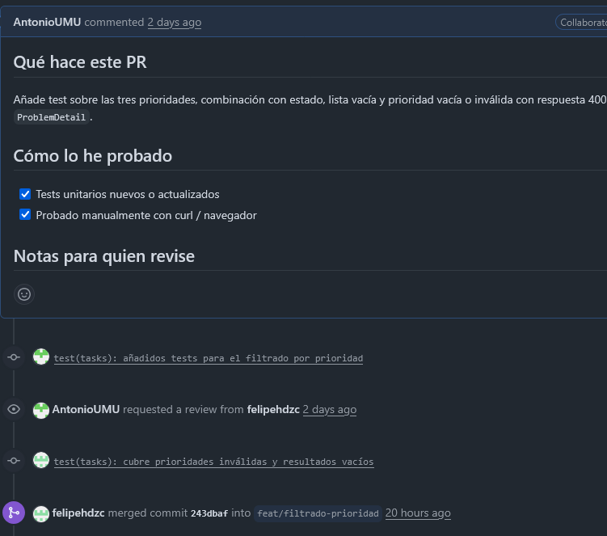

- Felipe crea el [**_pull request_**](https://github.com/david30520/boletines-pc/pull/2#issue-5637026044) en el repositorio `https://github.com/david30520/boletines-pc` de la rama `feat/filtrado-prioridad` hacia `main` para que los propietarios del repositorio revisen e incorporen el pull request.

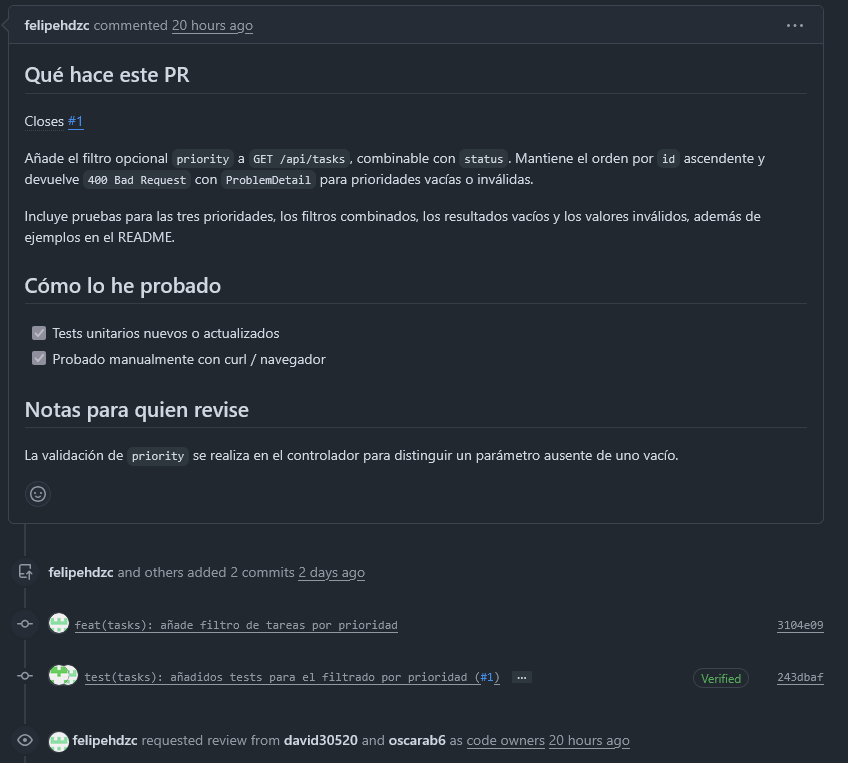

- Tras revisar el código, el pull request se fusiona con la rama principal.

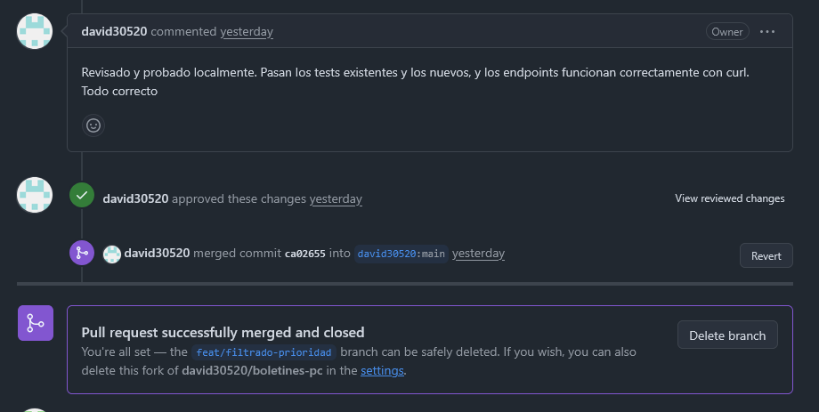
