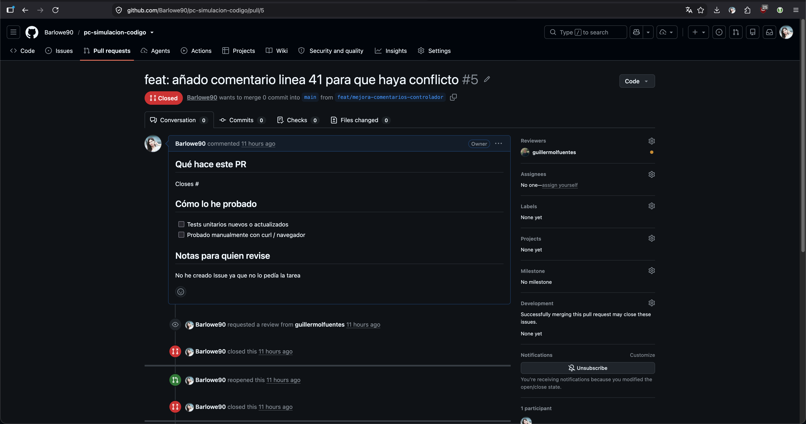
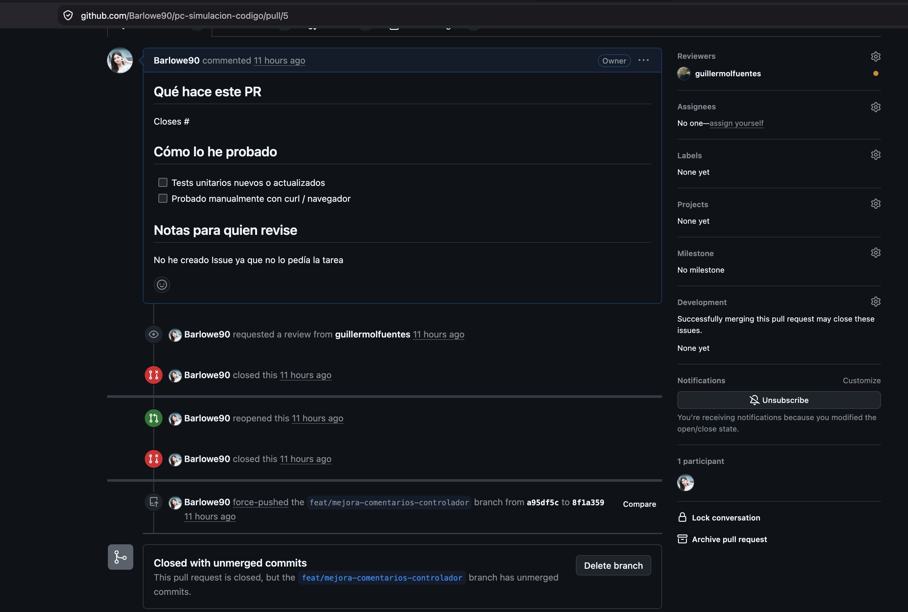
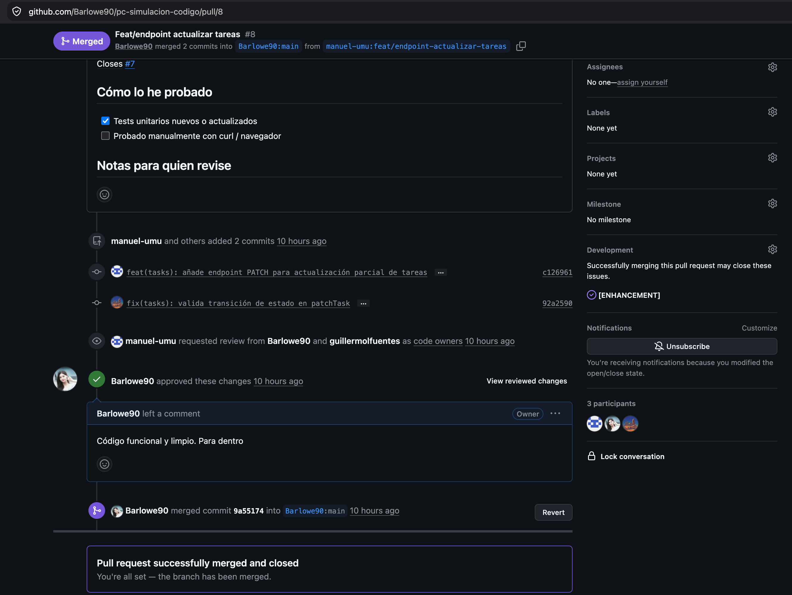

# Boletín 2 — GitHub y colaboración con Pull Requests

## Datos

- Repositorio: https://github.com/Barlowe90/pc-simulacion-codigo
- Integrantes: @Barlowe90, @guillermolfuentes
- Estrategia de merge elegida: **Squash and merge**

## Parte A — Publicar el repositorio

Se creó el repositorio público y se añadió al compañero como colaborador. El proyecto local del Boletín 1 se conectó con GitHub y se publicó en la rama `main`.

También se completó el `README.md` con la descripción del proyecto, requisitos, instrucciones de construcción y ejecución, configuración de hooks y pasos necesarios para empezar desde cero.

## Parte B — Gobernanza del repositorio

Se añadieron los siguientes archivos:

- `.github/PULL_REQUEST_TEMPLATE.md`
- `.github/ISSUE_TEMPLATE/bug.md`
- `.github/ISSUE_TEMPLATE/enhancement.md`
- `.github/CODEOWNERS`
- `CONTRIBUTING.md`

### Estrategia de merge

Se eligió **Squash and merge** como política de integración para mantener `main` con un historial sencillo, representando cada Pull Request como un único cambio significativo.

## Parte C — Protección de `main`

Se creó el ruleset **Regla boletin 2** sobre la rama `main`, configurando:

- Pull Request obligatorio antes de integrar cambios.
- Al menos una aprobación.
- Revisión obligatoria de Code Owners.
- Resolución obligatoria de conversaciones.
- Descartar aprobaciones anteriores cuando se añaden nuevos commits.
- Sin usuarios con permiso para saltarse las reglas.
- Bloqueo de force push.
- Bloqueo de eliminación de `main`.

Como comprobación se intentó realizar un `push` directo sobre `main` y GitHub rechazó la operación, obligando a trabajar mediante Pull Request.

No se tomó captura de esta comprobación.

## Parte D — Trabajo mediante Pull Requests

Se realizaron dos ciclos completos de trabajo mediante Issue, rama de feature, Pull Request y revisión cruzada.

### PR 1 — Búsqueda por texto

- Issue: [#2 — Mejora búsqueda por texto en la tarea](https://github.com/Barlowe90/pc-simulacion-codigo/issues/2)
- Rama: `feature/search-by-text`
- PR: [#1 — Feature/search by text](https://github.com/Barlowe90/pc-simulacion-codigo/pull/1)
- Autor: @guillermolfuentes
- Revisor: @Barlowe90
- Resultado: aprobado y fusionado en `main`.

La mejora añadió búsqueda de tareas por texto libre sobre título y descripción, junto con sus pruebas unitarias.

### PR 2 — Paginación

- Issue: [#3 — Añadir paginación al listado de tareas](https://github.com/Barlowe90/pc-simulacion-codigo/issues/3)
- Rama: `feat/paginacion-tareas`
- PR: [#4 — feat: añado paginacion](https://github.com/Barlowe90/pc-simulacion-codigo/pull/4)
- Autor: @Barlowe90
- Revisor: @guillermolfuentes
- Resultado: aprobado y fusionado en `main`.

La mejora añadió los parámetros `page` y `size` al listado de tareas, conservando los filtros y la ordenación existentes, y actualizando los tests y la documentación.

## Parte E — Resolución de conflictos

Para provocar el conflicto se utilizaron dos ramas que modificaban la misma zona del controlador.

La primera rama, `refactor/controller`, se fusionó mediante el [PR #6](https://github.com/Barlowe90/pc-simulacion-codigo/pull/6).

Después se abrió el [PR #5](https://github.com/Barlowe90/pc-simulacion-codigo/pull/5) desde la rama `feat/mejora-comentarios-controlador`. Como `main` ya contenía cambios sobre las mismas líneas, GitHub mostró un conflicto.

### PR con conflicto



El conflicto se resolvió en local haciendo rebase de la segunda rama sobre `main`:

```bash
git switch feat/mejora-comentarios-controlador
git fetch origin
git rebase origin/main
# resolver manualmente el conflicto
git add .
git rebase --continue
git push --force-with-lease origin feat/mejora-comentarios-controlador
```

Tras el push, GitHub actualizó automáticamente el Pull Request y dejó de mostrar el conflicto.

### PR después de resolver el conflicto



## Parte F — Colaboración mediante fork

Se realizó colaboración con otra pareja sin permisos de escritura directos, trabajando mediante forks en ambos sentidos.

### Otra pareja contribuye a nuestro repositorio

En nuestro repositorio se creó el Issue [#7](https://github.com/Barlowe90/pc-simulacion-codigo/issues/7), que proponía añadir actualización parcial de tareas mediante `PATCH /api/v1/tasks/{id}`.

La otra pareja realizó la implementación desde el fork `manuel-umu/pc-simulacion-codigo` y abrió el [PR #8 — Feat/endpoint actualizar tareas](https://github.com/Barlowe90/pc-simulacion-codigo/pull/8). El PR fue revisado, aprobado y fusionado en nuestro repositorio.

### Nuestra contribución al repositorio de la otra pareja

Se hizo fork del repositorio original:

- Repositorio original: https://github.com/EmilioG999/PracticasContinuas-MISUM
- Nuestro fork: https://github.com/Barlowe90/PracticasContinuas-MISUM

La otra pareja abrió el Issue [#7 — Filtrar tareas por prioridad](https://github.com/EmilioG999/PracticasContinuas-MISUM/issues/7).

La mejora se desarrolló en la rama `feature/filter-tasks-by-priority` de nuestro fork. Se añadió el filtrado por prioridad manteniendo la paginación existente y se ampliaron los tests para comprobar específicamente la combinación de prioridad y paginación.

Se abrió el [PR #8 — Feature/filter tasks by priority](https://github.com/EmilioG999/PracticasContinuas-MISUM/pull/8) contra el repositorio original. El PR fue aprobado por la otra pareja y posteriormente fusionado.

### Evidencia del PR aprobado en el repositorio de la otra pareja


