# Boletín 3

## Resumen de commits

| # | Mensaje del commit | Qué se hizo | Autor | Enlace |
|---|--------------------|-------------|-------|--------|
| 1 | `feat: añado libreria en maven y actualizo properties` | Se añadió Spring Boot Actuator al `pom.xml` y se configuraron los endpoints `health` e `info` en `application.properties`. | Barlowe90 | [1259967](https://github.com/Barlowe90/pc-simulacion-codigo/commit/12599673c6ba53e013d643a13896d1cd9a44aaf0) |
| 2 | `feat(persistence): migra a PostgreSQL con Docker Compose` | Sustitución de H2 por PostgreSQL y configuración de la conexión mediante variables de entorno. Incorporación de Docker Compose con API, base de datos, healthcheck y volumen persistente, comprobando la conservación y eliminación de los datos. | felipehdzc | [31e9761](https://github.com/Barlowe90/pc-simulacion-codigo/commit/31e9761880f2d0e9fc75f77e43672a1574b4b364) |
| 3 | `feat: añado env example y añado env a gitignore` | Se inició la incorporación del fichero `.env.example` para externalizar la configuración sensible. | Barlowe90 | [7b1c3fb](https://github.com/Barlowe90/pc-simulacion-codigo/commit/7b1c3fb915b4e75adcff6349eca83994b91d2c83) |
| 4 | `actualizado env example y gitignore` | Se definieron las variables de PostgreSQL en `.env.example` y se añadió `.env` al `.gitignore`. | Barlowe90 | [993d0ce](https://github.com/Barlowe90/pc-simulacion-codigo/commit/993d0ce900139de1e9df185d1026e86df02a85d5) |
| 5 | `feat: actualido docker-compose con variables de env` | Se sustituyeron las credenciales escritas directamente en `docker-compose.yml` por variables obtenidas de `.env`. | Barlowe90 | [dd89fae](https://github.com/Barlowe90/pc-simulacion-codigo/commit/dd89fae5c881f2d96845ec22780a2abf9df9a447) |
| 6 | `feat(docker): setup API containerization` | Se configuró el Dockerfile multi-stage y el `.dockerignore` para la contenerización de la API. | guillermolfuentes | [dae7333](https://github.com/Barlowe90/pc-simulacion-codigo/commit/dae7333486858d21533c162113a4cad767eee94e) |
| 7 | `feat: añade devcontainer para desarrollo` | Se creó el archivo `.devcontainer/devcontainer.json` para definir el entorno de desarrollo como código de forma estandarizada. | guillermolfuentes | [7514635](https://github.com/Barlowe90/pc-simulacion-codigo/commit/7514635158302bd362c5598a156ee5581896b063) |
| 8 | `docs(readme): documenta el arranque con Docker y Dev Container` | Actualización del README con los requisitos y pasos para arrancar mediante Docker Compose y Dev Container. Documentación de la configuración de .env, consulta de logs, comprobación de salud y parada de los servicios. | felipehdzc | [a45a49a](https://github.com/Barlowe90/pc-simulacion-codigo/commit/a45a49ac630f06282e1547767c8e62e287b671ad) |


## Detalle por commit

### 1. `feat: añado libreria en maven y actualizo properties`

- **Qué se hizo:** se añadió la dependencia `spring-boot-starter-actuator` al `pom.xml`. También se configuró `application.properties` para exponer los endpoints `health` e `info` y mostrar los detalles del estado únicamente cuando corresponda.
- **Autor:** Barlowe90.
- **Relación con el boletín:** Parte B — Endpoint de salud.
- **Comprobación:** se arrancó la aplicación y se ejecutó:

  ```bash
  curl http://localhost:8080/actuator/health
  ```

  obteniendo:

  ```json
  {"status":"UP"}
  ```

- **Uso de IA:** ChatGPT. Se utilizó como asistente para seguir paso a paso el Boletín 3 y comprobar la incorporación de Spring Boot Actuator y la configuración requerida para el endpoint de salud.

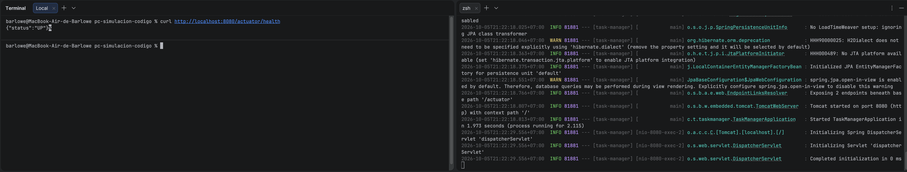


### 2. `feat(persistence): migra a PostgreSQL con Docker Compose`

- **Qué se hizo:** Se sustituyó la dependencia de H2 por el driver de PostgreSQL y se actualizó `application.properties` para obtener la conexión mediante variables de entorno y utilizar `spring.jpa.hibernate.ddl-auto=update`. Se añadió `docker-compose.yml` con los servicios de PostgreSQL y la API, un volumen persistente y un healthcheck para ordenar el arranque. Se comprobó la conservación de los datos tras ejecutar `docker compose down` y su eliminación al utilizar `docker compose down -v`.
- **Autor:** Felipe Hernández Cánovas.
- **Relación con el boletín:** apartado D — De H2 a PostgreSQL con Compose. Incluye la migración de la base de datos, la configuración de Compose y la comprobación de persistencia.
- **Uso de IA:** Se utilizó ChatGPT como apoyo para preparar los cambios y resolver problemas durante la ejecución. 


### 3. `feat: añado env example y añado env a gitignore`

- **Qué se hizo:** se creó el fichero `.env.example` como plantilla versionable para la configuración necesaria por Docker Compose.
- **Autor:** Barlowe90.
- **Relación con el boletín:** Parte E — Pasos 1 a 3, relacionados con la externalización de la configuración y los secretos.
- **Uso de IA:** ChatGPT. Se consultó qué contenido debía tener `.env.example` siguiendo exactamente el formato indicado por el boletín.


### 4. `actualizado env example y gitignore`

- **Qué se hizo:** se completó `.env.example` con las variables:

  ```dotenv
  POSTGRES_DB=tareas
  POSTGRES_USER=app
  POSTGRES_PASSWORD=cambia_esto
  ```

  y se añadió:

  ```gitignore
  .env
  ```

  al `.gitignore`, evitando que las credenciales locales sean versionadas.

- **Autor:** Barlowe90.
- **Relación con el boletín:** Parte E — creación de `.env.example`, creación del `.env` local y exclusión de `.env` de Git.
- **Uso de IA:** ChatGPT. Se utilizó para verificar qué fichero debía versionarse y cuál debía permanecer únicamente en el entorno local.


### 5. `feat: actualido docker-compose con variables de env`

- **Qué se hizo:** se modificó `docker-compose.yml` para eliminar las credenciales escritas directamente y sustituirlas por variables de entorno:

  ```yaml
  POSTGRES_DB: ${POSTGRES_DB}
  POSTGRES_USER: ${POSTGRES_USER}
  POSTGRES_PASSWORD: ${POSTGRES_PASSWORD:?Define POSTGRES_PASSWORD en el fichero .env}
  ```

  La API también obtiene de estas variables la URL, el usuario y la contraseña de PostgreSQL. El `healthcheck` utiliza `$${POSTGRES_USER}` y `$${POSTGRES_DB}` para que las variables se resuelvan dentro del contenedor.

- **Autor:** Barlowe90.
- **Relación con el boletín:** Parte E — Paso 5, uso de variables en `docker-compose.yml`.
- **Comprobación:** se ejecutó:

  ```bash
  docker compose config
  ```

  para verificar la sustitución de las variables y posteriormente:

  ```bash
  docker compose down -v
  docker compose up --build -d
  docker compose ps
  curl http://localhost:8080/actuator/health
  ```

  Tanto la API como PostgreSQL quedaron en estado `healthy` y el endpoint devolvió `{"status":"UP"}`.

- **Uso de IA:** ChatGPT. Se utilizó para aplicar la configuración del `docker-compose.yml` indicada por el boletín y verificar posteriormente la resolución de las variables.

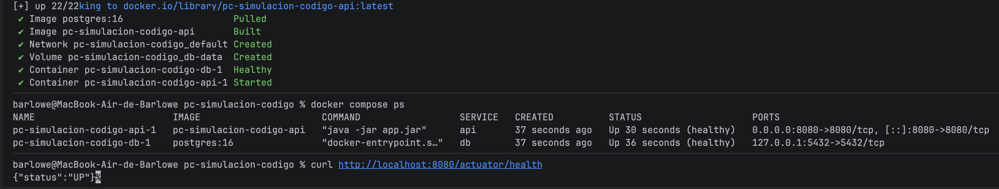

### 6. `feat(docker): setup API containerization`

- **Qué se hizo:** se creó un archivo `Dockerfile` en la raíz del proyecto configurado con un build multi-etapa (*multi-stage*). En la primera etapa se compila la aplicación usando una imagen de Maven y Java, y en la segunda se genera la imagen ligera para producción basada en el JRE. También se añadió un archivo `.dockerignore` para evitar enviar basura (como la carpeta local `target/`) y secretos (como el `.env`) al contexto de construcción de la imagen.
- **Autor:** Guillermo López Fuentes.
- **Relación con el boletín:** Parte C — Dockerfile multi-stage.
- **Comprobación:** se construyó la imagen (`docker build -t tareas-api:0.1 .`) y se ejecutó su contenedor (`docker run --rm -p 8080:8080 tareas-api:0.1`), verificando que el API se levantaba correctamente.

### 7. `feat: añade devcontainer para desarrollo`

- **Qué se hizo:** se añadió el directorio `.devcontainer` con el fichero `devcontainer.json`. Esto estandariza el entorno de desarrollo usando la especificación "Dev Containers". Se definió la imagen base de Java 21, la *feature* `docker-in-docker` para levantar dependencias en el propio contenedor, el mapeo de puertos y la descarga automática de las dependencias Maven en la fase `postCreateCommand`.
- **Autor:** Guillermo López Fuentes.
- **Relación con el boletín:** Parte F — Dev container.
- **Comprobación:** se reabrió el proyecto en VS Code empleando la opción *Reopen in Container* y se levantó el stack mediante `docker compose up --build`.

### 8. `docs(readme): documenta el arranque con Docker y Dev Container`

- **Qué se hizo:** Se actualizó el `README.md` con los requisitos y las instrucciones para arrancar el proyecto mediante Docker Compose y Dev Container. Se documentaron la preparación de `.env`, el arranque y la parada de los servicios, la consulta de logs, la comprobación de salud y la gestión del volumen de PostgreSQL. También se actualizó la descripción de la persistencia para reflejar el uso de PostgreSQL.
- **Autor:** Felipe Hernández Cánovas.
- **Relación con el boletín:** apartado G — Versionar los cambios, concretamente la documentación del arranque con Docker y Dev Container en el README y su entrega mediante un Pull Request.
- **Uso de IA:** Se utilizó Codex para analizar el arranque y documentar Docker y DevContainer.

## Descripción narrativa de lo hecho en la sesión y relación con los commits

### Parte A 

Esta parte consistía en verificar la instalación y funcionamiento de Docker y Docker Compose. Al disponer previamente de Docker para otros proyectos, no fue necesario realizar cambios en el repositorio.


### Parte B (Adri)

Se incorporó Spring Boot Actuator para proporcionar a la aplicación un endpoint que permita comprobar su estado.

El cambio quedó recogido en el commit [`1259967`](https://github.com/Barlowe90/pc-simulacion-codigo/commit/12599673c6ba53e013d643a13896d1cd9a44aaf0), que añade la dependencia de Actuator al `pom.xml` y configura los endpoints `health` e `info` en `application.properties`.

La comprobación se realizó mediante:

```bash
curl http://localhost:8080/actuator/health
```

obteniendo:

```json
{"status":"UP"}
```


### Parte C (Guille)

Esta parte consistió en crear el `Dockerfile` multi-stage que permite empaquetar la API en una imagen Docker portátil y segura, junto con el fichero `.dockerignore` que evita enviar ficheros innecesarios (o sensibles) al contexto de build.

El trabajo quedó recogido en el commit [`dae7333`](https://github.com/Barlowe90/pc-simulacion-codigo/commit/dae7333486858d21533c162113a4cad767eee94e).

#### Dockerfile multi-stage

El `Dockerfile` se divide en dos etapas claramente diferenciadas:

**Etapa 1 (`build`):** usa la imagen `maven:3.9-eclipse-temurin-21` para compilar el proyecto. Primero se copia únicamente el `pom.xml` y se descargan las dependencias con `mvn dependency:go-offline`; solo después se copia el código fuente en `src/`. Este orden es deliberado: si se modifica una clase Java pero no el `pom.xml`, Docker reutiliza la capa de descarga de dependencias y solo recompila el código, acelerando el build significativamente.

**Etapa 2 (`runtime`):** parte de una imagen base mínima `eclipse-temurin:21-jre` (solo el JRE, sin Maven ni JDK), lo que reduce notablemente el tamaño final y la superficie de ataque. Se instala `curl` (necesario para el healthcheck), se crea un usuario de sistema sin privilegios (`app`, UID 1001), se copia el JAR compilado en la etapa anterior y se arranca la aplicación con ese usuario. La instrucción `HEALTHCHECK` indica a Docker que comprobe periódicamente el endpoint `/actuator/health`.

```dockerfile
# ---- Etapa 1: build ----
FROM maven:3.9-eclipse-temurin-21 AS build
WORKDIR /app
COPY pom.xml .
RUN mvn -B dependency:go-offline
COPY src ./src
RUN mvn -B clean package -DskipTests

# ---- Etapa 2: runtime ----
FROM eclipse-temurin:21-jre
WORKDIR /app
RUN apt-get update \
    && apt-get install -y --no-install-recommends curl \
    && rm -rf /var/lib/apt/lists/*
RUN useradd --system --uid 1001 app
COPY --from=build /app/target/*.jar app.jar
USER app
EXPOSE 8080
HEALTHCHECK --interval=15s --timeout=3s --start-period=40s --retries=5 \
  CMD curl -fs http://localhost:8080/actuator/health | grep -q UP || exit 1
ENTRYPOINT ["java", "-jar", "app.jar"]
```

#### .dockerignore

Para evitar enviar al contexto de build ficheros que no son necesarios para compilar (y que podrían filtrar secretos o ralentizar el build), se creó `.dockerignore`:

```text
target/
.git/
.idea/
.vscode/
.devcontainer/
*.md
deploy/
.env
docker-compose*.yml
```

Nótese que `.env` aparece explícitamente: aunque no haya ninguna instrucción `COPY .env` en el Dockerfile, incluirlo evita que acabe en la imagen si alguien modifica el Dockerfile por error.

#### Construcción y prueba de la imagen

Se construyó la imagen y se arrancó un contenedor:

```bash
docker build -t tareas-api:0.1 .
docker run --rm -p 8080:8080 tareas-api:0.1
```

En otra terminal se comprobó que la API respondía:

```bash
curl http://localhost:8080/api/v1/tasks
```

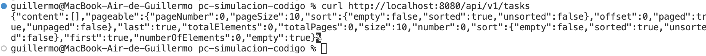

Ejecutando `docker ps` se esperó a que la columna `STATUS` mostrase `(healthy)`, lo que confirmó que el healthcheck funcionaba correctamente.

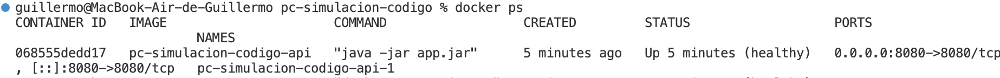

#### Comparación de tamaños (multi-stage vs. imagen de build)

Para ilustrar la ventaja del multi-stage build se construyó también solo la primera etapa:

```bash
docker build --target build -t tareas-api:build .
docker images tareas-api
```

La imagen `tareas-api:build` incluye Maven, el JDK completo y todo el caché de dependencias de Maven Central, lo que la hace considerablemente más grande. La imagen final `tareas-api:0.1` solo contiene el JRE y el JAR de la aplicación, resultando mucho más ligera.

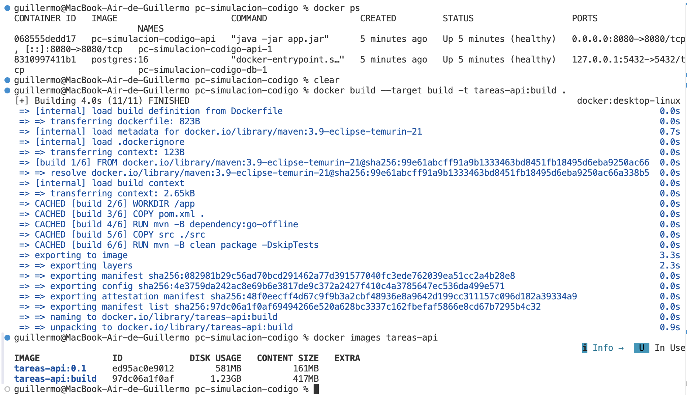


#### Demostración de la caché de capas

Para demostrar el impacto del orden de las instrucciones en el aprovechamiento de la caché se realizaron dos experimentos:

1. **Con el Dockerfile en su orden original** (`COPY pom.xml` antes que `COPY src`): se modificó una línea de una clase Java y se reconstruyó midiendo el tiempo con `time docker build -t tareas-api:0.1 .`. El build fue rápido porque Docker reutilizó la capa de dependencias (el `pom.xml` no había cambiado).

2. **Con el orden invertido** (`COPY src` antes que `COPY pom.xml`): al cambiar cualquier clase Java, Docker invalida la capa de `COPY src` y todas las siguientes, obligando a re-descargar todas las dependencias de Maven. El tiempo de build aumentó drásticamente.

Finalmente se restauró el Dockerfile a su orden original.


### Parte D — De H2 a PostgreSQL con Compose (Felipe)

Hemos creado una rama nueva para implementar el cambio de H2 a PostgreSQL:

```bash
git switch -c feat/postgresql-compose
```

En `pom.xml`, hemos sustituido la dependencia de H2 por el driver de PostgreSQL (`org.postgresql:postgresql`), manteniendo el ámbito `runtime` y Spring Data JPA como capa de persistencia.

Después, hemos eliminado de `application.properties` las propiedades de H2 y configurado la conexión mediante variables de entorno:

```properties
spring.datasource.url=${SPRING_DATASOURCE_URL}
spring.datasource.username=${SPRING_DATASOURCE_USERNAME}
spring.datasource.password=${SPRING_DATASOURCE_PASSWORD}
spring.datasource.driver-class-name=org.postgresql.Driver
spring.jpa.hibernate.ddl-auto=update
```

El cambio de `create-drop` a `update` permite conservar las tablas al cerrar la aplicación, en lugar de eliminarlas.

A continuación, hemos creado `docker-compose.yml` con dos servicios: `db`, que utiliza PostgreSQL 16, y `api`, que construye la imagen con el Dockerfile existente. La base de datos se llama `tareas`, utiliza el usuario `app` y almacena sus datos en el volumen `db-data`, montado en `/var/lib/postgresql/data`.

La API recibe las variables de conexión desde Compose y utiliza la URL `jdbc:postgresql://db:5432/tareas`. El nombre `db` identifica al servicio de PostgreSQL dentro de la red de Compose. Hemos añadido un healthcheck con `pg_isready` y la dependencia `condition: service_healthy` para que la API arranque cuando la base de datos esté preparada. La API hereda el healthcheck de su Dockerfile.

Para validar y levantar el conjunto, hemos ejecutado:

```bash
mvn clean verify
docker compose config
docker compose up --build -d
docker compose ps
curl http://localhost:8080/actuator/health
```

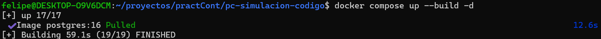
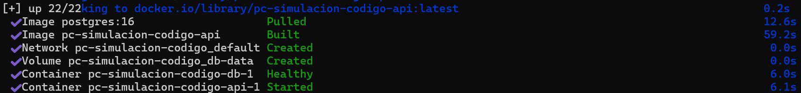

La compilación finalizó con `BUILD SUCCESS`. Hemos comprobado que ambos servicios estaban saludables y que el endpoint de salud devolvía `{"status":"UP"}`.

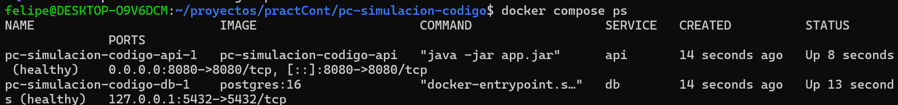
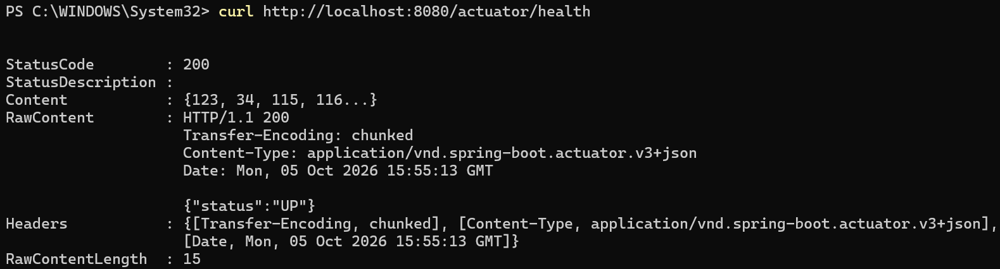

Para verificar la persistencia, hemos creado una tarea y consultado el listado:

```bash
curl -i -X POST http://localhost:8080/api/v1/tasks \
  -H "Content-Type: application/json" \
  -d '{"title":"Comprobar persistencia","status":"PENDING","priority":"MEDIUM","dueDate":"2099-12-31"}'

curl http://localhost:8080/api/v1/tasks
```

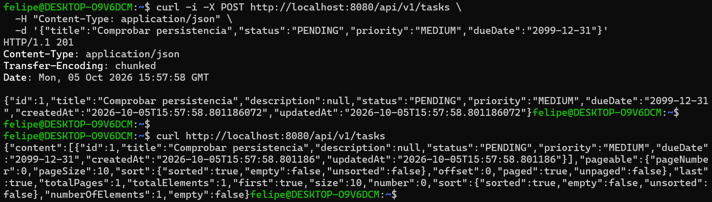

Después, hemos detenido y vuelto a levantar los servicios:

```bash
docker compose down
docker compose up -d
```
y al comprobar la tarea creada anteriormente podemos ver como sigue existiendo:
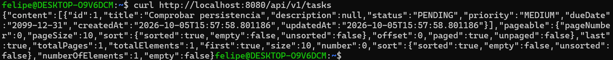

Una vez preparada la API, hemos repetido la consulta y comprobado que la tarea seguía almacenada. Finalmente, hemos repetido la prueba eliminando también el volumen:

```bash
docker compose down -v
docker compose up -d
```

Al consultar de nuevo, el listado estaba vacío (`"content":[]` y `"totalElements":0`). 
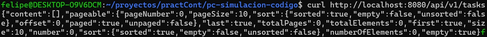

La diferencia entre ambos comandos es:

| Comando | Qué elimina | Resultado |
|---|---|---|
| `docker compose down` | Contenedores y red de Compose | Conserva el volumen y los datos. |
| `docker compose down -v` | Contenedores, red y volumen `db-data` | Elimina los datos. |

Los cambios se registraron en el commit [`31e9761`](https://github.com/Barlowe90/pc-simulacion-codigo/commit/31e9761880f2d0e9fc75f77e43672a1574b4b364), con el mensaje `feat(persistence): migra a PostgreSQL con Docker Compose`, y se integraron mediante el [PR #13](https://github.com/Barlowe90/pc-simulacion-codigo/pull/13).


### Parte E (Adri)

Se externalizó la configuración sensible de PostgreSQL utilizando un fichero `.env` local y una plantilla `.env.example` que sí puede almacenarse en Git.

Este trabajo está relacionado principalmente con los commits:

- [`7b1c3fb`](https://github.com/Barlowe90/pc-simulacion-codigo/commit/7b1c3fb915b4e75adcff6349eca83994b91d2c83)
- [`993d0ce`](https://github.com/Barlowe90/pc-simulacion-codigo/commit/993d0ce900139de1e9df185d1026e86df02a85d5)
- [`dd89fae`](https://github.com/Barlowe90/pc-simulacion-codigo/commit/dd89fae5c881f2d96845ec22780a2abf9df9a447)

Se creó `.env.example`, se aseguró que `.env` estuviese excluido mediante `.gitignore` y `.dockerignore`, y se sustituyeron en `docker-compose.yml` las credenciales escritas directamente por referencias a variables de entorno.

La sustitución se comprobó con:

```bash
docker compose config
```

Finalmente se levantó el stack completo y se comprobó que ambos servicios estaban en estado `healthy`.


### Parte F (Guille)
 
Esta parte consistió en definir el entorno de desarrollo del proyecto como código mediante un *dev container*, de forma que cualquier miembro del equipo que clone el repositorio obtenga automáticamente el mismo JDK, el mismo Maven y las mismas herramientas al abrir el proyecto en VS Code, sin necesidad de instalar nada en su máquina.

El trabajo quedó recogido en el commit [`7514635`](https://github.com/Barlowe90/pc-simulacion-codigo/commit/7514635158302bd362c5598a156ee5581896b063).

#### Fichero `.devcontainer/devcontainer.json`

```json
{
  "name": "tareas-api",
  "image": "mcr.microsoft.com/devcontainers/java:21",
  "features": {
    "ghcr.io/devcontainers/features/java:1": { "installMaven": "true" },
    "ghcr.io/devcontainers/features/docker-in-docker:2": { "moby": false }
  },
  "forwardPorts": [8080, 5432],
  "postCreateCommand": "test -f .env || cp .env.example .env; if [ -d .githooks ]; then git config core.hooksPath .githooks; fi; mvn -B dependency:go-offline",
  "customizations": {
    "vscode": { "extensions": ["vscjava.vscode-java-pack", "ms-azuretools.vscode-docker"] }
  }
}
```

#### Explicación de cada campo

- **`name`**: nombre descriptivo del dev container, que aparece en la barra de estado de VS Code cuando el entorno está activo.

- **`image`**: imagen base del contenedor de desarrollo. Se utiliza `mcr.microsoft.com/devcontainers/java:21`, una imagen oficial de Microsoft preconfigurada con Java 21, herramientas de desarrollo habituales y un usuario no-root (`vscode`).

- **`features`**: extensiones del contenedor que se instalan sobre la imagen base:
  - `ghcr.io/devcontainers/features/java:1` con `installMaven: true` instala Maven dentro del contenedor, de modo que el proyecto puede compilarse sin depender de la instalación local del desarrollador.
  - `ghcr.io/devcontainers/features/docker-in-docker:2` permite ejecutar comandos Docker *dentro* del propio contenedor de desarrollo. Esto es imprescindible para poder lanzar `docker compose up` desde el terminal integrado de VS Code cuando se trabaja dentro del dev container. La opción `"moby": false` utiliza el Docker Engine oficial en lugar de Moby (la variante open-source), lo que garantiza mayor compatibilidad.

- **`forwardPorts`**: puertos del contenedor que se mapean automáticamente a la máquina anfitriona. Con `[8080, 5432]` se puede acceder a la API en `http://localhost:8080` y conectarse a PostgreSQL en el puerto `5432` directamente desde el navegador o un cliente SQL del anfitrión, sin configuración adicional.

- **`postCreateCommand`**: secuencia de órdenes que se ejecuta una única vez, justo después de crear el contenedor. Está compuesta por tres partes separadas por `;`:
  1. `test -f .env || cp .env.example .env` — si no existe ya un fichero `.env`, lo crea copiando la plantilla `.env.example`. Así el desarrollador dispone de una configuración funcional desde el primer arranque.
  2. `if [ -d .githooks ]; then git config core.hooksPath .githooks; fi` — si el proyecto tiene un directorio `.githooks` con hooks personalizados, los activa en el repositorio local. Esto garantiza que los hooks (por ejemplo, para validar el formato de los mensajes de commit) funcionen también dentro del contenedor.
  3. `mvn -B dependency:go-offline` — descarga todas las dependencias de Maven al caché local del contenedor. De esta forma, los builds posteriores no necesitan conexión a internet y son más rápidos.

- **`customizations.vscode.extensions`**: lista de extensiones de VS Code que se instalan automáticamente en el editor cuando se abre el dev container:
  - `vscjava.vscode-java-pack`: paquete oficial de Microsoft con soporte completo para Java (IntelliSense, depurador, herramientas de proyecto Maven/Gradle, etc.).
  - `ms-azuretools.vscode-docker`: extensión de Docker para VS Code que permite gestionar imágenes, contenedores y ficheros `docker-compose.yml` con interfaz gráfica.

#### Verificación

Se instaló la extensión **Dev Containers** en VS Code y se usó la opción *Dev Containers: Reopen in Container*. Una vez dentro del contenedor, se ejecutó:

```bash
docker compose up --build
```

y se comprobó que la API respondía correctamente en `http://127.0.0.1:8080/actuator/health` desde el navegador de la máquina anfitriona.


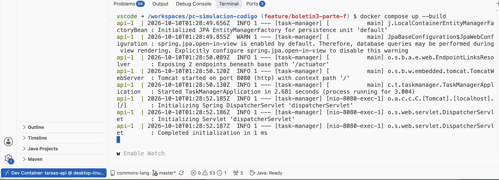

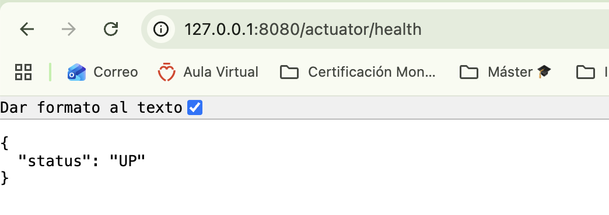


### Parte G — Versionar los cambios (Felipe)

Creamos una rama nueva para documentar el arranque del proyecto con Docker Compose y Dev Container:

```bash
git switch -c docs/readme-docker-devcontainer
```

En esta rama hemos actualizado el `README.md`, incorporando los requisitos y los pasos necesarios para utilizar ambos entornos. También hemos actualizado la descripción de la persistencia para reflejar el uso de PostgreSQL.

Para **Docker Compose**, hemos explicado cómo preparar el archivo `.env` a partir de `.env.example`, configurar las credenciales y levantar la API junto con PostgreSQL:

```bash
cp .env.example .env
docker compose up --build -d
```

También hemos incluido los comandos para consultar el estado de los servicios, revisar los logs y comprobar la salud de la API:

```bash
docker compose ps
docker compose logs -f api
curl -fsS http://localhost:8080/actuator/health
```

Además, hemos documentado cómo detener el conjunto con `docker compose down`, aclarando que conserva los datos, mientras que `docker compose down -v` elimina también el volumen de PostgreSQL.

Para **Dev Container**, hemos descrito los requisitos de Docker, VS Code y la extensión Dev Containers, así como la apertura del proyecto mediante **Dev Containers: Reopen in Container**. Las instrucciones explican la preparación automática del entorno, la configuración de `.env`, el arranque de los servicios desde la terminal integrada y el acceso a la API mediante los puertos reenviados por VS Code.

Finalmente, hemos registrado y publicado los cambios:

```bash
git add README.md
git commit -m "docs(readme): documenta el arranque con Docker y Dev Container"
git push -u origin docs/readme-docker-devcontainer
```

Los cambios corresponden al commit [`a45a49a`](https://github.com/Barlowe90/pc-simulacion-codigo/commit/a45a49ac630f06282e1547767c8e62e287b671ad).

Después hemos abierto el [Pull Request #16](https://github.com/Barlowe90/pc-simulacion-codigo/pull/16) hacia `main`, con el título **«docs(readme): documenta el arranque con Docker y Dev Container»**. Los cambios afectan únicamente al `README.md` ya que fuimos realizando distintos commits por cada uno de los apartados del boletín.

### Parte H (Adri)

Se investigó y realizó la publicación de la imagen Docker en Docker Hub.

Esta parte no generó un commit específico porque el propio boletín indica que no debe modificar el repositorio del proyecto.

Primero se construyó la imagen:

```bash
docker build -t tareas-api:0.1 .
```

Después se etiquetó para el repositorio personal de Docker Hub:

```bash
docker tag tareas-api:0.1 barlowe/tareas-api:0.1
```

y finalmente se publicó:

```bash
docker push barlowe/tareas-api:0.1
```

La publicación terminó correctamente con el digest:

```text
sha256:acbd7895d717aeae1cb49a36ab4402af82b372c3641f6aab2cbf18e9b5756995
```

La imagen publicada es:

```text
barlowe/tareas-api:0.1
```

Durante el primer intento de `docker push` se produjo un timeout de red. Al repetir la operación, Docker reutilizó las capas que ya habían sido transferidas y terminó correctamente la publicación.


### Parte I (Guille)

Esta parte no genera cambios en el repositorio del proyecto. El objetivo es crear un entorno de pruebas reproducible para un proyecto open source externo usando Docker.

#### Paso 1 — Elegir repositorio

Se eligió [**Apache Commons Lang**](https://github.com/apache/commons-lang), una librería Java de la Apache Software Foundation con más de 2.500 estrellas en GitHub y millones de descargas mensuales en Maven Central. Proporciona utilidades que complementan la API estándar de Java: manipulación de cadenas, arrays, fechas, reflexión, etc. Es un proyecto maduro y activo con una amplia batería de tests unitarios, lo que lo hace ideal para este ejercicio.

#### Paso 2 — Analizar requisitos

**Fuentes consultadas:** [`pom.xml`](https://github.com/apache/commons-lang/blob/master/pom.xml) del repositorio.

#### Análisis de requisitos

Del `pom.xml` se extraen los siguientes datos relevantes:

```xml
<!-- Versión de Java de compilación (fuente: pom.xml, bloque <properties>) -->
<maven.compiler.source>1.8</maven.compiler.source>
<maven.compiler.target>1.8</maven.compiler.target>

<!-- Framework de tests (fuente: pom.xml, bloque <dependencies>) -->
<groupId>org.junit.jupiter</groupId>
<artifactId>junit-jupiter</artifactId>

<groupId>org.junit-pioneer</groupId>
<artifactId>junit-pioneer</artifactId>
```

| Requisito | Valor | Fuente |
|-----------|-------|--------|
| Lenguaje | Java | `pom.xml` |
| Versión de compilación | Java 8 (`source` y `target` = 1.8) | `pom.xml` → `<properties>` |
| Gestor de build | Maven | fichero `pom.xml` en la raíz |
| Framework de tests | JUnit Jupiter (JUnit 5) + junit-pioneer | `pom.xml` → `<dependencies>` |
| Runner de tests | Maven Surefire Plugin | implícito en el ciclo `mvn test` |
| Dependencias del sistema | Ninguna (solo JDK + Maven) | `pom.xml` |

**Nota sobre la imagen base:** aunque el `pom.xml` declara `source/target 1.8`, se usa `maven:3.9-eclipse-temurin-21` porque el JDK 21 compila código con `--release 8` sin problema y mantiene coherencia con las imágenes ya usadas en la Parte C del proyecto.

#### Paso 3 — Crear el Dockerfile

Se crea un fichero `Dockerfile.test` dentro del directorio clonado (nombre distinto al `Dockerfile` del proyecto para no confundirlos):

```dockerfile
# Dockerfile.test – entorno reproducible para los tests de Apache Commons Lang
FROM maven:3.9-eclipse-temurin-21

WORKDIR /project

# 1. Copiar solo el descriptor de dependencias y descargarlas.
#    Si el pom.xml no cambia, Docker reutiliza esta capa en builds sucesivos.
COPY pom.xml .
RUN mvn -B dependency:go-offline -q

# 2. Copiar el código fuente (producción y tests) y ejecutar la suite.
COPY src ./src
RUN mvn -B test
```

**Justificación del diseño:**
- Se usa una sola etapa: no hay artefacto final que publicar, el objetivo único es ejecutar tests.
- El orden `COPY pom.xml` → `dependency:go-offline` → `COPY src` aprovecha la caché de capas: si solo cambia el código, Docker no re-descarga las dependencias.
- `-B` activa el modo *batch* de Maven (sin interacción ni colores ANSI), adecuado para contenedores.
- `-q` silencia la descarga de dependencias para no contaminar el output; se omite en `mvn test` para ver el resultado completo.

#### Paso 4 — Construir y ejecutar los tests

```bash
# 1. Clonar el repositorio (solo la última revisión, más rápido)
git clone --depth 1 https://github.com/apache/commons-lang.git
cd commons-lang

# 2. Construir la imagen (el Dockerfile.test debe estar dentro del directorio)
docker build -f Dockerfile.test -t commons-lang-test .

# 3. Ejecutar los tests dentro del contenedor
docker run --rm commons-lang-test
```

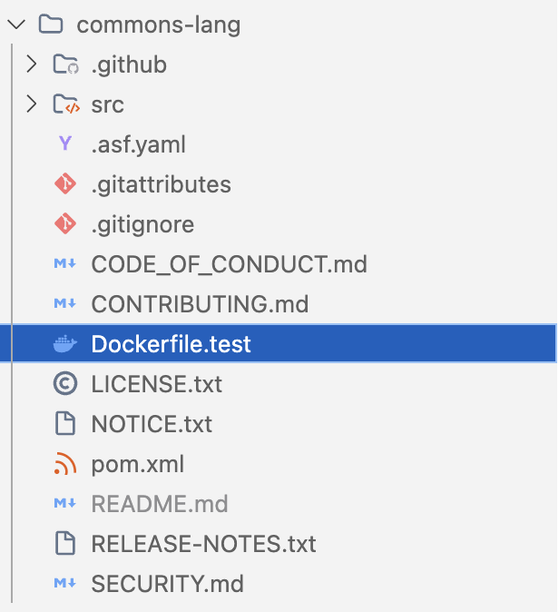

#### Resultado esperado

Al ejecutar el contenedor, Maven compila las clases de producción y de test y lanza la suite con Surefire. La salida al final del proceso muestra el éxito en la ejecución de los tests:

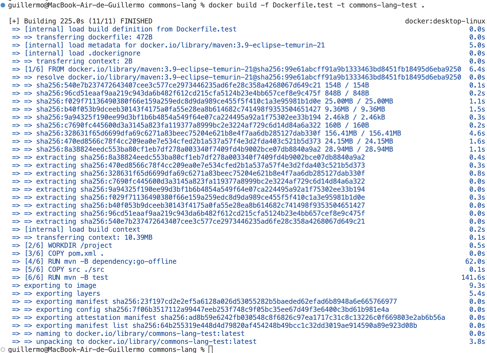

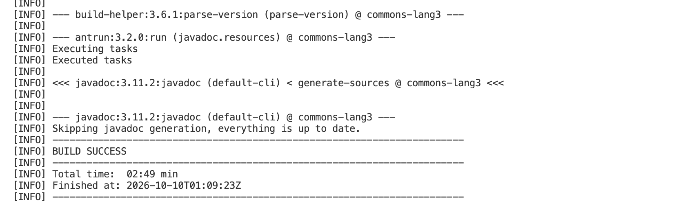


<!-- Incluir capturas de pantalla de lo que no queda reflejado en commits -->