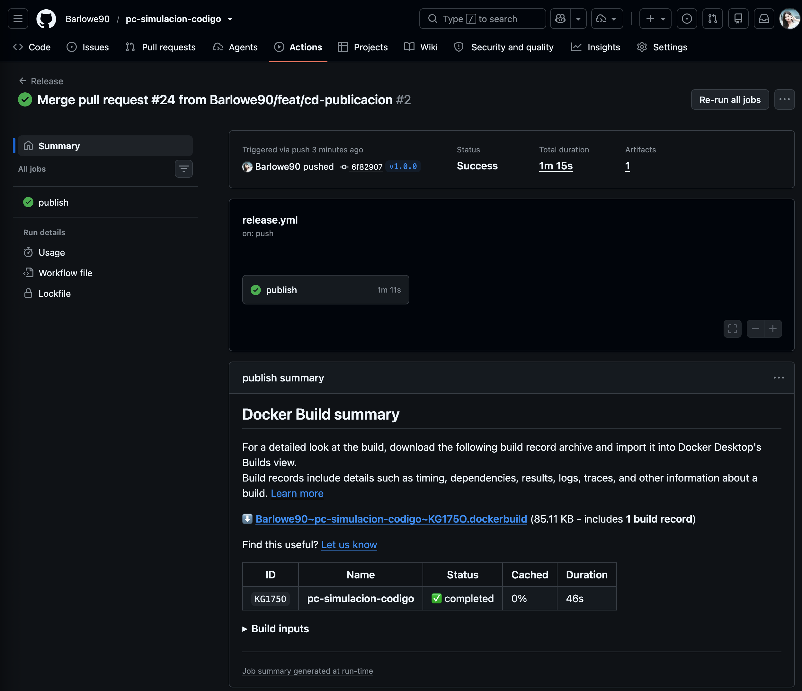
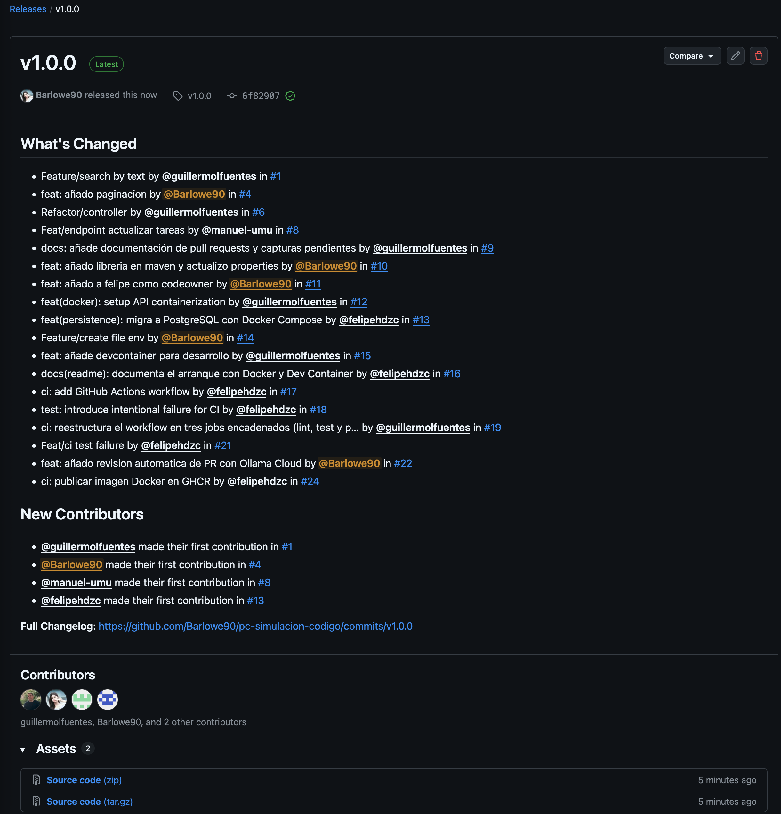
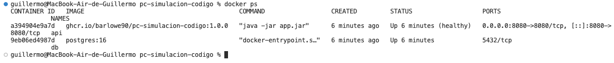
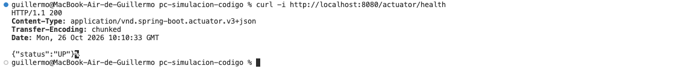
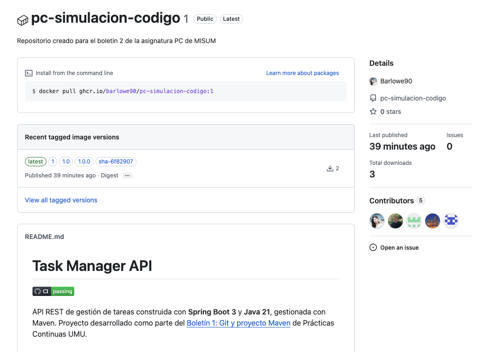
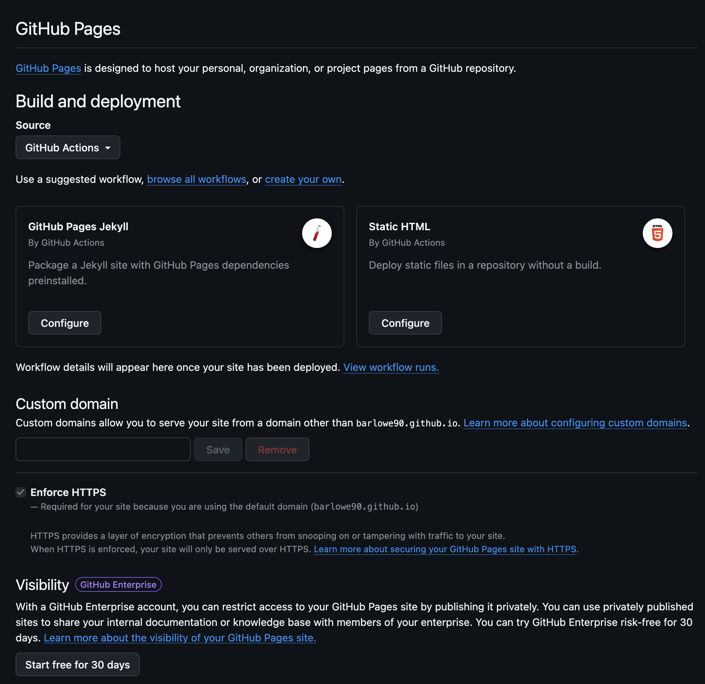

#  Boletín 5

## Resumen de commits

Los siguientes commits corresponden a la **parte D (GitHub Pages)** realizada por Adri en la rama `docs/publicacion-boletines`. Los enlaces a los commits estarán disponibles en GitHub cuando se suba la rama. Los compañeros incorporarán al resumen los commits de sus partes cuando completen la memoria.

| # | Mensaje del commit | Qué se hizo | Autor | Enlace |
|---|---|---|---|---|
| 1 | `docs: incorporo a memoria boletin 4` | Se añade `docs/boletin4.md` y sus capturas en `docs/imagenes/boletin4/`. | Adri (`Barlowe90`) | [ee2f78a](https://github.com/Barlowe90/pc-simulacion-codigo/commit/ee2f78a) |
| 2 | `feat(docs): genera sitio HTML desde Markdown` | Se añade el generador Python, su dependencia y las exclusiones de archivos generados. | Adri (`Barlowe90`) | [8a00b58](https://github.com/Barlowe90/pc-simulacion-codigo/commit/8a00b58) |
| 3 | `ci: publica documentación en GitHub Pages` | Se añade el workflow de construcción y publicación automática de la documentación. | Adri (`Barlowe90`) | [00e0cb2](https://github.com/Barlowe90/pc-simulacion-codigo/commit/00e0cb2) |

## Detalle por commit

### 1. `docs: incorporo a memoria boletin 4` (`ee2f78a`)

- **Qué se hizo:** se incorporó la memoria del Boletín 4 a `docs/boletin4.md` y sus capturas a `docs/imagenes/boletin4/`, conservando los nombres y la organización por boletín utilizada en OneDrive. Los archivos que anteriormente estaban directamente en `docs/` se organizaron en `docs/old/` para no mezclarlos con las nuevas memorias.
- **Autor:** Adri (`Barlowe90`).
- **Relación con el boletín:** parte D, incorporar las memorias Markdown al repositorio de la API y mantener las capturas necesarias para su publicación.
- **Verificación:** se abrió el Markdown en el visor local y las imágenes se visualizaron correctamente.
- **Uso de IA:** ChatGPT (OpenAI) orientó la estructura de carpetas y la separación de commits. La copia, comprobación y el commit se realizaron manualmente.

### 2. `feat(docs): genera sitio HTML desde Markdown` (`8a00b58`)

- **Qué se hizo:** se creó `docs/generar_site.py` para transformar los archivos `docs/*.md` en `docs/site/*.html`, generar un `index.html` con enlaces a cada boletín y copiar `docs/imagenes/` manteniendo las subcarpetas. También se añadió `docs/requirements.txt` con la dependencia Python `Markdown` y se actualizaron las exclusiones del `.gitignore` para `docs/site/` y `.venv/`.
- **Autor:** Adri (`Barlowe90`).
- **Relación con el boletín:** parte D, generación local de una web HTML navegable a partir de los Markdown sin versionar los archivos generados.
- **Verificación:** se ejecutó `python docs/generar_site.py`, que generó `boletin4.html` y `index.html`. Se abrió `docs/site/index.html` en el navegador y se comprobaron la navegación y las imágenes. `git status` confirmó que ni `docs/site/` ni `.venv/` se incluían entre los cambios.
- **Uso de IA:** ChatGPT (OpenAI) ayudó a elaborar el script Python, la lista de dependencias y las instrucciones de prueba; el código se revisó y se ejecutó localmente.

### 3. `ci: publica documentación en GitHub Pages` (`00e0cb2`)

- **Qué se hizo:** se creó `.github/workflows/pages.yml`, preparado para ejecutarse en cada `push` a `main`. El workflow instala Python y las dependencias, genera `docs/site/`, lo empaqueta como artefacto de GitHub Pages y lo despliega con las acciones oficiales de GitHub.
- **Autor:** Adri (`Barlowe90`).
- **Relación con el boletín:** parte D, automatizar la publicación de la documentación mediante GitHub Actions.
- **Verificación:** se comprobó que el archivo quedó registrado en un commit independiente y que el árbol de trabajo estaba limpio. **La ejecución y publicación real del workflow todavía están pendientes de fusionar la PR en `main`.**
- **Uso de IA:** ChatGPT (OpenAI) ayudó a preparar y explicar el workflow. La creación del archivo, su revisión y el commit se realizaron manualmente.


## Descripción narrativa de lo hecho en la sesión y relación con los commits


### Parte A (Felipe)

...

### Parte B (Adri)

#### Objetivo

Publicar la primera versión de la API de tareas (`v1.0.0`) mediante una **etiqueta anotada de Git**, comprobar que GitHub Actions construye y publica la imagen versionada en **GitHub Container Registry (GHCR)** y crear una **Release** de GitHub con sus notas de cambios.

#### B.1. Crear y subir la etiqueta anotada

Antes de publicar la versión, se comprobó que la parte A estaba integrada en `main` mediante la PR [#24 — Publicar imagen Docker en GHCR](https://github.com/Barlowe90/pc-simulacion-codigo/pull/24), y que el último commit de la rama era:

```text
6f82907 (HEAD -> main, origin/main, origin/HEAD) Merge pull request #24 from Barlowe90/feat/cd-publicacion
```

Se ejecutaron los comandos indicados en el boletín:

```bash
git tag -a v1.0.0 -m "Primera versión publicable de la API de tareas"
git push origin v1.0.0
```

- `git tag -a` crea una **etiqueta anotada** que identifica de forma estable la versión `v1.0.0` en el commit `6f82907`.
- `git push origin v1.0.0` publica esa etiqueta en el repositorio remoto.

La terminal confirmó la publicación:

```text
To https://github.com/Barlowe90/pc-simulacion-codigo.git
 * [new tag]         v1.0.0 -> v1.0.0
```

La etiqueta no crea un commit nuevo: apunta al commit ya existente de `main`.

#### B.2. Comprobar el workflow y las etiquetas de la imagen

Al subir `v1.0.0`, se activó de nuevo el workflow `.github/workflows/release.yml`, ya que está configurado para ejecutarse con las etiquetas `v*.*.*`.

- **Ejecución:** [Release — v1.0.0](https://github.com/Barlowe90/pc-simulacion-codigo/actions/runs/40300201430).
- **Resultado:** `Success`; el job `publish` terminó correctamente.
- **Duración:** 1 minuto y 15 segundos.
- **Publicación:** `ghcr.io/barlowe90/pc-simulacion-codigo`.

Se verificó en los registros de la ejecución que el workflow construyó y publicó las siguientes etiquetas:

| Etiqueta de imagen | Significado |
|---|---|
| `1.0.0` | Versión semántica exacta. |
| `1.0` | Última publicación de la serie 1.0. |
| `1` | Última publicación de la versión mayor 1. |
| `sha-6f82907` | Trazabilidad al commit utilizado. |
| `latest` | Imagen publicada desde la rama principal. |

**Evidencia:** workflow `Release` finalizado correctamente para `v1.0.0`.



Durante esta ejecución GitHub mostró dos avisos informativos: la deprecación de Node.js 20 en determinadas acciones y el próximo cambio de `ubuntu-latest`. No impidieron la publicación.

#### B.3. Crear la Release en GitHub

Desde la sección **Releases** del repositorio se creó una publicación utilizando la etiqueta existente `v1.0.0`, con el título **v1.0.0**. Se utilizó la opción **Generate release notes** para generar las notas de cambios, que recogen las contribuciones realizadas mediante las PR anteriores.

- **Release publicada:** [v1.0.0](https://github.com/Barlowe90/pc-simulacion-codigo/releases/tag/v1.0.0).
- **Commit asociado:** [`6f82907`](https://github.com/Barlowe90/pc-simulacion-codigo/commit/6f82907f9d3e0e4eeb1dd7293057f3ee0274c2fb).
- **Estado:** publicada y marcada por GitHub como `Latest`.

**Evidencia:** publicación de la Release `v1.0.0` con notas generadas y enlace al commit.



#### Resultado y uso de IA

Se completaron los tres requisitos de la parte B: etiqueta anotada publicada, imagen Docker versionada en GHCR y Release de GitHub con sus notas. **Esta parte no añadió commits** al repositorio: la etiqueta y la Release referencian el commit existente.

**Uso de IA:** se utilizó **ChatGPT (OpenAI)** como apoyo para revisar el estado del repositorio y del workflow, interpretar las comprobaciones de GitHub Actions y guiar paso a paso la publicación de la versión y la redacción de esta memoria. Los comandos Git fueron ejecutados manualmente.


### Parte C (Guille)


#### C.1. Creación de la red y despliegue de PostgreSQL

Dado que desde el Boletín 3 la aplicación ya no cuenta con base de datos H2 en memoria y requiere un servidor PostgreSQL real para inicializar su capa de persistencia (Spring Data JPA / HikariCP), se creó en primer lugar una red Docker aislada y se levantó el contenedor de la base de datos con las credenciales y esquema correspondientes:

```bash
docker network create tareas-net

docker run -d --name db --network tareas-net \
  -e POSTGRES_DB=tareas \
  -e POSTGRES_USER=app \
  -e POSTGRES_PASSWORD=secret_local_dev \
  postgres:16
```

- **Red:** `tareas-net` (driver `bridge`), permitiendo la resolución de nombres por DNS interno entre contenedores.
- **Contenedor BD:** `db`, ejecutando PostgreSQL 16 y escuchando en el puerto interno `5432`.

#### C.2. Descarga de la imagen desde GHCR y arranque de la API

A continuación, se descargó la imagen `1.0.0` publicada en GHCR por el pipeline de la Parte B. Dado que el paquete del repositorio se encuentra configurado como público, la descarga no requirió autenticación previa mediante Personal Access Token (PAT):

```bash
docker pull ghcr.io/barlowe90/pc-simulacion-codigo:1.0.0
```

Salida del comando `docker pull`:
```text
1.0.0: Pulling from barlowe90/pc-simulacion-codigo
Digest: sha256:aadeaec2570c7a5783a7849750e7093cd9af6c28233b1c97f9f63988ad091619
Status: Downloaded newer image for ghcr.io/barlowe90/pc-simulacion-codigo:1.0.0
ghcr.io/barlowe90/pc-simulacion-codigo:1.0.0
```

Se procedió al arranque del contenedor `api`, conectándolo a la misma red `tareas-net`, mapeando el puerto `8080` al host y configurando las variables de entorno de conexión hacia el contenedor `db`:

```bash
docker run -d --name api --network tareas-net -p 8080:8080 \
  -e SPRING_DATASOURCE_URL=jdbc:postgresql://db:5432/tareas \
  -e SPRING_DATASOURCE_USERNAME=app \
  -e SPRING_DATASOURCE_PASSWORD=secret_local_dev \
  ghcr.io/barlowe90/pc-simulacion-codigo:1.0.0
```

Se comprobaron los registros de inicio del contenedor (`docker logs api`), confirmando que la aplicación Spring Boot `v1.0.0` arrancó correctamente y estableció la conexión con PostgreSQL mediante HikariCP:

```text
  .   ____          _            __ _ _
 /\\ / ___'_ __ _ _(_)_ __  __ _ \ \ \ \
( ( )\___ | '_ | '_| | '_ \/ _` | \ \ \ \
 \\/  ___)| |_)| | | | | || (_| |  ) ) ) )
  '  |____| .__|_| |_|_| |_\__, | / / / /
 =========|_|==============|___/=/_/_/_/

 :: Spring Boot ::                (v3.3.4)

INFO 1 --- [task-manager] [main] c.t.taskmanager.TaskManagerApplication   : Starting TaskManagerApplication v1.0.0 using Java 21.0.12.1
INFO 1 --- [task-manager] [main] com.zaxxer.hikari.HikariDataSource       : HikariPool-1 - Starting...
INFO 1 --- [task-manager] [main] com.zaxxer.hikari.pool.HikariPool        : HikariPool-1 - Added connection org.postgresql.jdbc.PgConnection@350342e0
INFO 1 --- [task-manager] [main] com.zaxxer.hikari.HikariDataSource       : HikariPool-1 - Start completed.
INFO 1 --- [task-manager] [main] o.s.b.w.embedded.tomcat.TomcatWebServer  : Tomcat started on port 8080 (http) with context path '/'
INFO 1 --- [task-manager] [main] c.t.taskmanager.TaskManagerApplication   : Started TaskManagerApplication in 8.602 seconds
```

#### C.3. Verificación de salud y endpoints

Con ambos contenedores en ejecución (`docker ps`), se validó la disponibilidad de la API consultando el endpoint de salud de Spring Boot Actuator:

```bash
curl -i http://localhost:8080/actuator/health
```

Respuesta del servidor:
```http
HTTP/1.1 200 
Content-Type: application/vnd.spring-boot.actuator.v3+json
Transfer-Encoding: chunked
Date: Mon, 26 Oct 2026 10:03:22 GMT

{"status":"UP"}
```

El estado `{"status":"UP"}` confirma que el servicio web está activo, el servidor Tomcat atiende peticiones en el puerto `8080` y la conexión con la base de datos PostgreSQL está plenamente operativa.

Adicionalmente, se verificó el endpoint REST principal de tareas (`GET /api/v1/tasks`):

```bash
curl -i http://localhost:8080/api/v1/tasks
```

Respuesta:
```http
HTTP/1.1 200 
Content-Type: application/json
Transfer-Encoding: chunked

{"content":[],"pageable":{"pageNumber":0,"pageSize":10,"sort":{"sorted":true,"empty":false,"unsorted":false},"offset":0,"paged":true,"unpaged":false},"last":true,"totalPages":0,"totalElements":0,"first":true,"size":10,"number":0,"sort":{"sorted":true,"empty":false,"unsorted":false},"numberOfElements":0,"empty":true}
```

#### C.4. Limpieza de los recursos Docker

Tras validar el funcionamiento y obtener las evidencias, se procedió a detener y eliminar los contenedores y la red creada:

```bash
docker rm -f db api && docker network rm tareas-net
```

#### Evidencias

*Despliegue y ejecución de los contenedores Docker en la red `tareas-net`:*


<!--
  📸 CAPTURA 1 — Contenedores db y api activos en docker ps
  PASOS:
  1. Abre una ventana de terminal.
  2. Ejecuta:
       docker ps
  3. Asegúrate de que se visualicen claramente:
     - El contenedor 'api' con la imagen 'ghcr.io/barlowe90/pc-simulacion-codigo:1.0.0', estado 'Up' y puerto '0.0.0.0:8080->8080/tcp'.
     - El contenedor 'db' con la imagen 'postgres:16', estado 'Up'.
  4. Realiza la captura de pantalla mostrando la terminal con la salida de `docker ps`.
  5. Guarda el archivo como: docs/imagenes/boletin5/boletin-5-parte-c-docker-ps.png
-->

*Verificación del endpoint de salud `/actuator/health` devolviendo UP:*


<!--
  📸 CAPTURA 2 — Verificación curl a /actuator/health
  PASOS:
  1. En la terminal ejecuta:
       curl -i http://localhost:8080/actuator/health
  2. Comprueba que en la salida se aprecie:
       HTTP/1.1 200
       {"status":"UP"}
  3. Opcionalmente abre en tu navegador web: http://localhost:8080/actuator/health
  4. Realiza la captura de pantalla de la terminal (o del navegador) donde se vea claramente el resultado {"status":"UP"}.
  5. Guarda el archivo como: docs/imagenes/boletin5/boletin-5-parte-c-actuator-health.png
-->

*Paquete de la imagen publicado en GitHub Packages:*


<!--
  📸 CAPTURA 3 — GitHub Packages (registro GHCR del repositorio)
  PASOS:
  1. Ve en el navegador a: https://github.com/Barlowe90/pc-simulacion-codigo/pkgs/container/pc-simulacion-codigo
     (O en el repositorio, en la columna derecha de la pestaña principal, sección "Packages" -> haz clic en "pc-simulacion-codigo").
  2. En la pestaña "Package versions" se verán listadas las etiquetas generadas: 1.0.0, 1.0, 1, sha-6f82907 y latest.
  3. Realiza una captura de pantalla mostrando esta página web con las etiquetas de versión visibles.
  4. Guarda el archivo como: docs/imagenes/boletin5/boletin-5-parte-c-ghcr-package.png
-->

#### Resultado y uso de IA

**Esta parte no añadió commits al repositorio de código**, ya que corresponde íntegramente a tareas de prueba, validación de la imagen publicada y verificación de infraestructura local con Docker.

**Uso de IA:** se utilizó **Github Copilot** como asistente para la redacción de los resultados. Los comandos fueron ejecutados individualmente.

### Parte D (Todos)

- Boletín 1 y 2 (de Felipe) y 3 (común) - Felipe
- Boletín 4 - Adri (hecho)
- Boletín 5 - Adri o Guille

### Parte D (Todos) — Publicar la documentación en GitHub Pages

#### D.1. Incorporación de memorias y organización de las imágenes

Se acordó organizar las memorias Markdown en `docs/`, con las capturas en subcarpetas por boletín (`docs/imagenes/boletin1/`, `boletin2/`, etc.), siguiendo la estructura compartida en OneDrive. Se conservó el contenido anterior de `docs/` en `docs/old/`.

Adri incorporó `docs/boletin4.md` junto a sus imágenes y comprobó visualmente que las referencias relativas funcionaban. Este trabajo se registró en el commit [`ee2f78a`](https://github.com/Barlowe90/pc-simulacion-codigo/commit/ee2f78a).

**Reparto acordado:** Felipe se ocupa de los boletines 1, 2 y 3; Adri se encargó del Boletín 4 y del generador y la configuración de Pages. La memoria definitiva del Boletín 5 se incorporará más adelante mediante **otra rama y otra PR**, cuando esté terminada.

#### D.2. Generación del sitio HTML en local

Se creó el script `docs/generar_site.py` (commit [`8a00b58`](https://github.com/Barlowe90/pc-simulacion-codigo/commit/8a00b58)) que:

- Convierte todos los archivos `*.md` situados directamente en `docs/` en páginas HTML dentro de `docs/site/`.
- Genera un `index.html` para navegar entre las memorias.
- Copia `docs/imagenes/` a `docs/site/imagenes/` respetando la organización por boletín, de modo que las referencias relativas a capturas sigan funcionando.
- No procesa los archivos históricos de `docs/old/`.

Para probarlo en macOS se creó un entorno virtual y se instaló la dependencia recogida en `docs/requirements.txt`:

```bash
python3 -m venv .venv
source .venv/bin/activate
python -m pip install -r docs/requirements.txt
python docs/generar_site.py
open docs/site/index.html
deactivate
```

La generación local produjo la salida:

```text
Generado: boletin4.html
Sitio generado correctamente en docs/site/
```

Se abrió el índice en el navegador y se verificó que el Boletín 4, sus imágenes y los enlaces de navegación funcionaban correctamente. La carpeta `docs/site/` se excluyó mediante `.gitignore`, ya que su contenido se genera automáticamente; también se ignoró `.venv/`.

#### D.3. Automatización con GitHub Actions

En el commit [`00e0cb2`](https://github.com/Barlowe90/pc-simulacion-codigo/commit/00e0cb2) se añadió `.github/workflows/pages.yml`. Está preparado para ejecutarse con cada `push` a `main` y contiene dos jobs:

1. **`build`:** descarga el repositorio, configura Python, instala las dependencias, ejecuta el generador y sube `docs/site/` como artefacto de Pages.
2. **`deploy`:** utiliza las acciones oficiales de GitHub Pages para publicar dicho artefacto, con los permisos `pages: write` e `id-token: write`.

Esto automatiza la regeneración de la documentación cada vez que se incorporen cambios a la rama principal. **Todavía no se ha verificado una ejecución del workflow después de la fusión**, ya que los cambios estaban en la rama `docs/publicacion-boletines`.

#### D.4. Activación de GitHub Pages en el repositorio

Como propietario del repositorio, Adri accedió a **Settings → Pages → Build and deployment** y cambió **Source** a **GitHub Actions**. En la pantalla se comprobó que esa opción estaba seleccionada y que HTTPS estaba activado. No fue necesario configurar los workflows sugeridos de Jekyll o Static HTML, ya que se había preparado uno propio.

**Evidencia: configuración de la fuente de publicación en GitHub Pages.**



#### D.5. Estado al redactar la memoria y tareas pendientes

Se preparó una única rama, `docs/publicacion-boletines`, con tres commits diferenciados: incorporación del Boletín 4 (`ee2f78a`), generador HTML (`8a00b58`) y workflow de Pages (`00e0cb2`). Se comprobó que el árbol de trabajo estaba limpio.

**Pendiente de realizar y verificar:** subir la rama, abrir la PR, obtener la revisión requerida, fusionarla en `main` y comprobar que el workflow publica correctamente la web y que las imágenes funcionan en la URL final. La memoria del Boletín 5 se añadirá con otra PR cuando esté completa; el generador detectará automáticamente ese Markdown una vez integrado. Por tanto, **no se declara todavía completada la publicación pública de GitHub Pages**.

#### Uso de IA

Se utilizó **ChatGPT (OpenAI)** para orientar la estructura de archivos, generar y explicar el script Python y el workflow de GitHub Actions, y guiar las comprobaciones locales y la documentación. Los archivos se prepararon y probaron localmente y los commits se ejecutaron manualmente por el estudiante.

<!-- Incluir capturas de pantalla de lo que no queda reflejado en commits -->