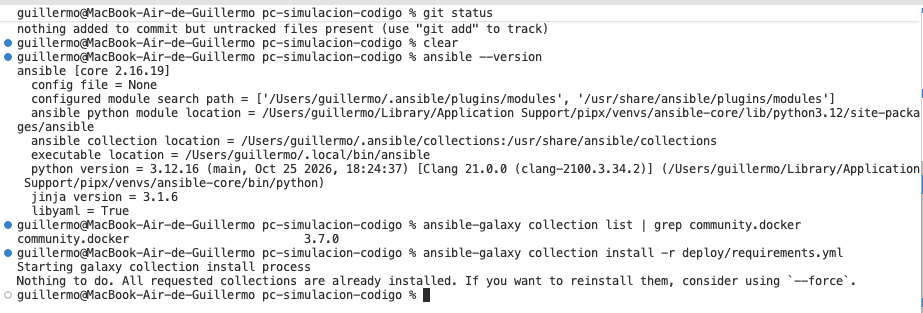
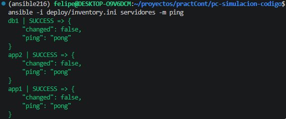
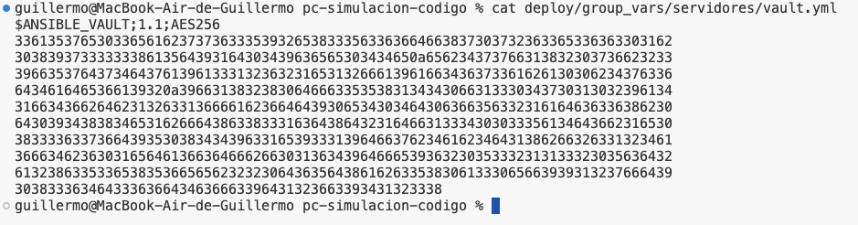
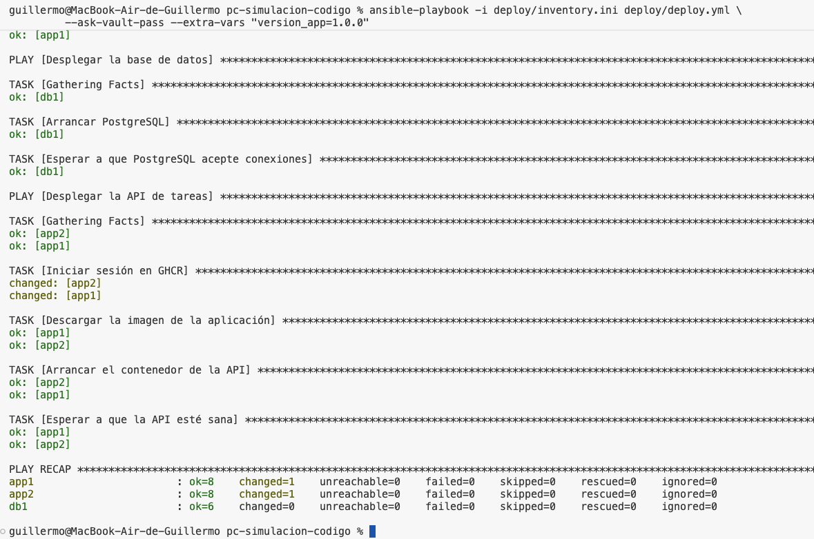
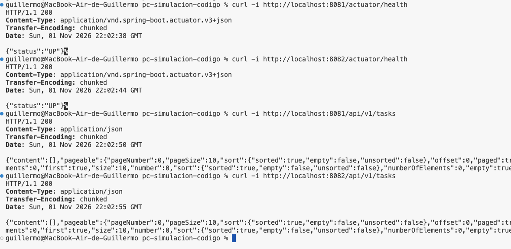
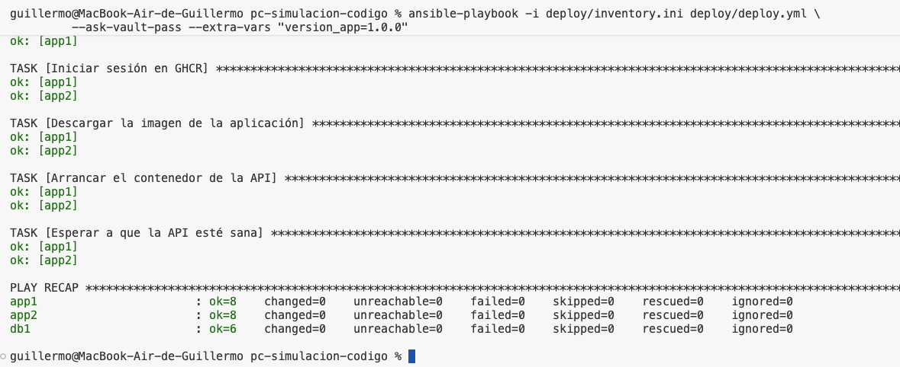
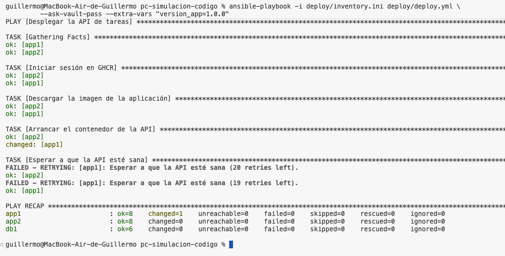

# Boletín 6

## Resumen de commits

| # | Mensaje del commit | Qué se hizo | Autor | Enlace |
|---|---|---|---|---|
| 1 | `feat(ansible): añade requisitos de la collection community.docker` | Se instala Ansible `core 2.16.19` mediante `pipx` y la collection `community.docker:3.7.0`; se declara la dependencia en `deploy/requirements.yml`. | Guille | [deba7bd](https://github.com/Barlowe90/pc-simulacion-codigo/commit/deba7bd) |
| 2 | `feat(ansible): añadir inventario de servidores para Ansible` | Se creó el inventario con los grupos `app`, `db` y `servidores`, y las opciones de conexión SSH. | `felipehdzc` | [af9cd48](https://github.com/Barlowe90/pc-simulacion-codigo/commit/af9cd4861b25a546be4212b8bf8e6ab366b93d75) |
| 3 | `feat(ansible): añadir playbook de despliegue` | Se añadió el playbook para preparar Docker, desplegar PostgreSQL y desplegar dos réplicas de la API desde GHCR. | `felipehdzc` | [03e83c4](https://github.com/Barlowe90/pc-simulacion-codigo/commit/03e83c41da15d3411e8e26056aaef0811328c3f3) |
| 4 | `feat(deploy): protege credenciales con ansible-vault` | Se crea y cifra `deploy/group_vars/servidores/vault.yml` con Ansible Vault (AES-256) para proteger credenciales de GHCR y PostgreSQL. | Guille | [dd06f03](https://github.com/Barlowe90/pc-simulacion-codigo/commit/dd06f03) |

## Detalle por commit

### 1. `feat(ansible): añade requisitos de la collection community.docker` (`deba7bd`)

- **Qué se hizo:** se instaló Ansible `core 2.16.19` mediante `pipx` y se instaló la collection `community.docker:3.7.0` con su dependencia transitiva `community.library_inventory_filtering_v1:1.1.5`. Se creó el fichero `deploy/requirements.yml` para declarar la dependencia de la collection de forma reproducible, de modo que cualquier miembro del equipo pueda instalarla con un único comando.
- **Autor:** Guille.
- **Relación con el boletín:** Parte A — instalación de Ansible y sus dependencias.
- **Uso de IA:** se utilizó **Antigravity (Google DeepMind)** para verificar la instalación, instalar la collection y generar el fichero `deploy/requirements.yml`.

### 2. `feat(ansible): añadir inventario de servidores para Ansible`

- **Qué se hizo:** Se creó `deploy/inventory.ini`. Los servidores `app1` y `app2` se incluyeron en el grupo `app`, mientras que `db1` se incluyó en `db`. Ambos grupos se agruparon bajo `servidores`. Se configuraron la dirección de conexión, el puerto SSH de cada servidor, el usuario y las variables comunes. La conexión se verificó con el módulo `ping` de Ansible, obteniendo `pong` en los tres servidores.
- **Autor:** Felipe 
- **Relación con el boletín:** Parte C, creación del inventario y comprobación del acceso de Ansible a toda la flota.
- **Uso de IA:** Se utilizó ChatGPT para diagnosticar la incompatibilidad entre Ansible y el Python de los contenedores.

### 3. `feat(ansible): añadir playbook de despliegue`

- **Qué se hizo:** Se creó `deploy/deploy.yml`, organizado en tres plays: preparación de Docker en toda la flota, despliegue de PostgreSQL en el grupo `db` y despliegue de la API en el grupo `app`. Se configuró la imagen de GHCR del proyecto con una versión concreta, el volumen persistente de PostgreSQL, las variables de conexión de Spring Boot y las comprobaciones de disponibilidad. Las tareas que manejan credenciales utilizan `no_log: true`.
- **Autor:** Felipe
- **Relación con el boletín:** Parte D, implementación del playbook de despliegue sobre varios servidores.
- **Uso de IA:** Se utilizó ChatGPT para adaptar el playbook del enunciado al repositorio y la descripción del PR.

### 4. `feat(deploy): protege credenciales con ansible-vault` (`dd06f03`)

- **Qué se hizo:** creación del archivo de variables cifrado `deploy/group_vars/servidores/vault.yml` mediante Ansible Vault con el algoritmo AES-256. Se definieron las 5 variables sensibles requeridas por el playbook de despliegue (`ghcr_user`, `ghcr_token`, `db_name`, `db_user` y `db_pass`). De este modo, las credenciales quedan versionadas en el repositorio sin exponer secretos en texto claro ni depender de argumentos `--extra-vars` en la línea de comandos.
- **Autor:** Guille.
- **Relación con el boletín:** Parte E — gestión segura de credenciales con Ansible Vault.
- **Uso de IA:** se utilizó **Antigravity (Google DeepMind)** para comprobar la concordancia con las variables usadas en `deploy/deploy.yml`, cifrar el archivo con `ansible-vault` y estructurar la documentación técnica y pasos de evidencia.


## Descripción narrativa de lo hecho en la sesión y relación con los commits


### Parte A (Guille)


#### A.1. Instalación de Ansible

Ansible se instaló mediante **`pipx`**, que aísla el paquete y sus dependencias en un entorno virtual propio sin interferir con el Python del sistema:

```bash
pipx install --include-deps ansible-core
```

Se verificó la versión instalada con:

```bash
~/.local/bin/ansible --version
```

Salida obtenida:

```text
ansible [core 2.16.19]
  config file = None
  configured module search path = ['/Users/guillermo/.ansible/plugins/modules', '/usr/share/ansible/plugins/modules']
  ansible python module location = /Users/guillermo/Library/Application Support/pipx/venvs/ansible-core/lib/python3.12/site-packages/ansible
  ansible collection location = /Users/guillermo/.ansible/collections:/usr/share/ansible/collections
  executable location = /Users/guillermo/.local/bin/ansible
  python version = 3.12.16 (main, Oct 25 2026, 18:24:37) [Clang 21.0.0 (clang-2100.3.34.2)]
  jinja version = 3.1.6
  libyaml = True
```

El ejecutable de Ansible reside en `~/.local/bin/`. Para invocarlo directamente sin la ruta completa se añadió esa carpeta al `PATH`:

```bash
echo 'export PATH="$HOME/.local/bin:$PATH"' >> ~/.zshrc && source ~/.zshrc
```

#### A.2. Instalación de la collection `community.docker`

La collection `community.docker` aporta los módulos `docker_container`, `docker_image`, `docker_login` y demás módulos usados en los playbooks del boletín. Se instaló la versión exacta indicada en el enunciado:

```bash
ansible-galaxy collection install community.docker:3.7.0
```

Salida obtenida:

```text
Starting galaxy collection install process
Process install dependency map
Starting collection install process
Downloading https://galaxy.ansible.com/api/v3/.../community-docker-3.7.0.tar.gz
Installing 'community.docker:3.7.0' to '/Users/guillermo/.ansible/collections/ansible_collections/community/docker'
community.docker:3.7.0 was installed successfully
Installing 'community.library_inventory_filtering_v1:1.1.5' to '...'
community.library_inventory_filtering_v1:1.1.5 was installed successfully
```

Se verificó que la collection quedó instalada correctamente:

```bash
ansible-galaxy collection list | grep community.docker
```

Salida:

```text
community.docker                         3.7.0
```

#### A.3. Declarar la dependencia en el repositorio

Para que la instalación sea reproducible en cualquier entorno (máquina de otro compañero, runner de CI), se creó el fichero `deploy/requirements.yml`:

```yaml
collections:
  - name: community.docker
    version: "3.7.0"
# se instala con:  ansible-galaxy collection install -r deploy/requirements.yml
```

Se verificó que el fichero funciona correctamente instalando desde él:

```bash
ansible-galaxy collection install -r deploy/requirements.yml
```

Salida (idempotente: la collection ya estaba instalada):

```text
Starting galaxy collection install process
Nothing to do. All requested collections are already installed.
```
#### Evidencias

*Verificación de instalación de Ansible y collection community.docker:*




### Parte B (Adri - hecho)

...


### Parte C (Felipe)

En esta parte, commit [af9cd48](https://github.com/Barlowe90/pc-simulacion-codigo/commit/af9cd4861b25a546be4212b8bf8e6ab366b93d75), añadí el inventario `deploy/inventory.ini`.

Se han separado las máquinas según su función. El grupo `app` contiene `app1` y `app2`, y el grupo `db` contiene `db1`. El grupo `servidores` reúne a ambos para poder aplicar tareas comunes a toda la flota.

Todos los destinos utilizan `ansible_host=localhost`, porque Ansible se ejecuta en WSL y accede a cada contenedor mediante un puerto SSH diferente. También se definieron el intérprete `/usr/bin/python3`, el usuario y las opciones de conexión comunes.

La primera comprobación con Ansible falló con el siguiente error:

```text
SyntaxError: future feature annotations is not defined
```

Para localizar la causa comprobé las versiones:

```bash
ansible --version
python3 --version
docker exec app1 python3 --version
```

En WSL tenía Ansible Core `2.21.5`, ejecutándose con Python `3.14.4`, mientras que el contenedor utilizaba Python `3.6.5`. La versión de Ansible instalada no era compatible con ese Python remoto.

Para seguir la versión indicada en el boletín preparé un entorno con Python 3.12 y Ansible Core 2.16.x:

```bash
pipx install uv
uv venv --python 3.12 ~/.venvs/ansible216
uv pip install --python ~/.venvs/ansible216/bin/python 'ansible-core>=2.16,<2.17'
source ~/.venvs/ansible216/bin/activate
```

Con el entorno activado, instalé la colección declarada en el proyecto y repetí la comprobación:

```bash
ansible-galaxy collection install -r deploy/requirements.yml
ansible -i deploy/inventory.ini servidores -m ping
```

Esta vez al intentar hacer ping a toda la flota obtuve:



El resultado confirmó que Ansible podía conectarse por SSH y ejecutar su módulo en los tres servidores.

### Parte D (Felipe)

Para realizar esta parte, commit [03e83c4](https://github.com/Barlowe90/pc-simulacion-codigo/commit/03e83c41da15d3411e8e26056aaef0811328c3f3), añadí el playbook `deploy/deploy.yml`.

El playbook se divide en tres bloques que se ejecutan en orden:

| Play                 | Grupo destino | Tareas principales                                                                           |
| -------------------- | ------------- | -------------------------------------------------------------------------------------------- |
| Preparar Docker      | `servidores`  | Instalar `docker.io` y `python3-docker`, y arrancar `dockerd`.                               |
| Desplegar PostgreSQL | `db`          | Arrancar `postgres:16` con un volumen persistente y esperar a que acepte conexiones.         |
| Desplegar la API     | `app`         | Autenticarse en GHCR, descargar la imagen, arrancar la API y consultar su endpoint de salud. |

En el primer bloque se instala Docker en cada servidor simulado. Como estos contenedores no utilizan systemd, el demonio se arranca con `nohup` y se espera a que `docker info` responda. La opción `creates` evita repetir la tarea de arranque mientras exista el archivo `/var/run/docker.pid`. También se establece `cache_valid_time: 3600` para reutilizar durante una hora la caché de paquetes.

El segundo bloque define el contenedor `tareas-db`, basado en `postgres:16`. El volumen `tareas-db-data` guarda los datos de PostgreSQL. El usuario, la contraseña y el nombre de la base se reciben mediante las variables `db_user`, `db_pass` y `db_name`. Se configura una comprobación con `pg_isready` y una espera sobre el puerto `5432` antes de continuar.

En el tercer bloque adapté el nombre de la imagen al que publica el workflow de release del repositorio:

```yaml
version_app: "1.0.0"
imagen: "ghcr.io/barlowe90/pc-simulacion-codigo:{{ version_app }}"
host_bd: "{{ groups['db'][0] }}"
```

La variable `version_app` selecciona una versión concreta de la imagen y puede sobrescribirse en los despliegues posteriores. La variable `host_bd` toma el primer servidor del grupo `db`, que en este inventario es `db1`.

Ambas réplicas reciben las variables de entorno de Spring Boot para conectarse a la misma base de datos. La URL se construye de esta forma:

```text
jdbc:postgresql://db1:5432/<nombre_de_la_base>
```

Los contenedores desplegados utilizan `network_mode: host` respecto al Docker que corre dentro de cada servidor simulado. Así, la API comparte la red de `app1` o `app2`, y PostgreSQL comparte la de `db1`. Los servidores exteriores pertenecen a la red común de Compose, donde `db1` es el nombre del servicio de base de datos.

Para la API se utilizan `state: started`, `restart_policy: always` y `recreate: false`. Esta configuración evita forzar una recreación en cada ejecución cuando el contenedor ya coincide con el estado solicitado. La comprobación práctica de la idempotencia mediante ejecuciones repetidas corresponde a la parte F.

El último paso del playbook consulta `http://localhost:8080/actuator/health` desde cada servidor de aplicación y espera una respuesta HTTP `200` con estado `UP`.

Las credenciales de GHCR y PostgreSQL se referencian mediante variables. Las tareas que las manejan incluyen `no_log: true`. Su configuración con Ansible Vault corresponde a la parte E.

Los dos commits se enviaron a la rama `feat/ansible-inventario-playbook` y se presentó el [PR #32](https://github.com/Barlowe90/pc-simulacion-codigo/pull/32) hacia `main`.

Las comprobaciones realizadas en esta sesión fueron el arranque de la flota, el acceso SSH y el `ping` de Ansible a los tres servidores. El despliegue completo, las pruebas de la API, la idempotencia, el cambio de versión y el rollback quedan para la parte F, una vez preparadas las credenciales de la parte E. La automatización desde GitHub Actions corresponde a la parte G.

### Parte E (Guille)


#### E.1. Ubicación de variables en Ansible (`group_vars`)

Ansible incorpora un mecanismo canónico para asociar variables a grupos de máquinas: cualquier fichero YAML ubicado en la ruta `deploy/group_vars/<nombre_grupo>/` se carga automáticamente para todos los hosts pertenecientes a dicho grupo.

Dado que en `deploy/inventory.ini` se definió el grupo paraguas `[servidores:children]` (que engloba a `app` y `db`), se ubicó el archivo cifrado en:

```text
deploy/group_vars/servidores/vault.yml
```

Así, tanto las máquinas de aplicación (`app1`, `app2`) como la de base de datos (`db1`) disponen de acceso a sus respectivas credenciales durante la ejecución del playbook.

#### E.2. Variables protegidas

El archivo contiene las 5 credenciales necesarias para los tres plays de `deploy/deploy.yml`:

| Variable | Descripción | Destino en el despliegue |
|---|---|---|
| `ghcr_user` | Usuario de GitHub (`Barlowe90`) | Login en GitHub Container Registry (`docker_login`) |
| `ghcr_token` | Token de acceso personal (PAT con scope `read:packages`) | Descarga de la imagen de la API desde GHCR |
| `db_name` | Nombre de la base de datos (`tareas`) | Creación y conexión a PostgreSQL |
| `db_user` | Usuario de la base de datos (`app`) | Creación y conexión a PostgreSQL |
| `db_pass` | Contraseña del usuario de la base de datos | Creación y conexión a PostgreSQL |

#### E.3. Creación y cifrado con Ansible Vault (AES-256)

Se creó y cifró el fichero mediante `ansible-vault` empleando el estándar de cifrado simétrico AES-256:

```bash
ansible-vault create deploy/group_vars/servidores/vault.yml
```

Para modificar el archivo en el futuro manteniendo el cifrado se utiliza:

```bash
ansible-vault edit deploy/group_vars/servidores/vault.yml
```

Y para consultar su contenido sin abrir el editor:

```bash
ansible-vault view deploy/group_vars/servidores/vault.yml
```

#### E.4. Verificación de la seguridad en el repositorio

Se verificó con el comando `cat` que el archivo almacenado en el repositorio Git es completamente ilegible y está protegido con la cabecera `$ANSIBLE_VAULT;1.1;AES256`:

```bash
cat deploy/group_vars/servidores/vault.yml
```

Los tokens utilizados durante las pruebas fueron revocados posteriormente 

#### Evidencias

*Fichero vault.yml cifrado en el repositorio:*




### Parte F (Guille)


#### F.1. Arranque de la infraestructura simulada

Antes de ejecutar el playbook es necesario que los tres contenedores que hacen de servidores destino (`app1`, `app2`, `db1`) estén levantados y escuchando por SSH:

```bash
docker compose -f deploy/servidores/docker-compose.yml up -d
```


#### F.2. Lanzamiento del despliegue con Ansible Vault

Se invocó el playbook indicando el inventario, solicitando interactivamente la clave maestra del almacén seguro (`--ask-vault-pass`) e inyectando la versión semántica de la aplicación a desplegar:

```bash
ansible-playbook -i deploy/inventory.ini deploy/deploy.yml \
  --ask-vault-pass --extra-vars "version_app=1.0.0"
```

El despliegue transcurre en tres fases orquestadas secuencialmente:

1. **Flota completa (`servidores`):** instalación de `docker.io` y arranque del demonio `dockerd` en segundo plano en cada contenedor.
2. **Base de datos (`db1`):** arranque del contenedor `tareas-db` (PostgreSQL 16) con volumen persistente `tareas-db-data` y comprobación de salud mediante `pg_isready`.
3. **Réplicas de la API (`app1`, `app2`):** autenticación en GitHub Container Registry (`ghcr.io`) con las credenciales del Vault, descarga de la imagen versionada `ghcr.io/Barlowe90/pc-simulacion-codigo:1.0.0`, arranque del contenedor `tareas-api` con `network_mode: host` (apuntando a `db1:5432`) y ejecución del *smoke test* sobre `/actuator/health` hasta confirmar estado `UP`.

#### F.3. Verificación de alta disponibilidad y réplicas con cURL

Una vez finalizado el playbook se comprobó el correcto funcionamiento de ambas réplicas, las cuales responden en los puertos mapeados al anfitrión (`8081` para `app1` y `8082` para `app2`), accediendo de forma compartida al mismo backend de base de datos en `db1`:

```bash
# Comprobación de salud en ambas réplicas
curl -i http://localhost:8081/actuator/health
curl -i http://localhost:8082/actuator/health

# Comprobación del endpoint funcional de tareas
curl -i http://localhost:8081/api/v1/tasks
curl -i http://localhost:8082/api/v1/tasks
```

Ambas réplicas devuelven código `200 OK` y estado `{"status":"UP"}`.

#### F.4. Verificación de idempotencia (`changed=0`)

Una propiedad fundamental de Ansible es la **idempotencia**: ejecutar el mismo playbook repetidas veces sobre un sistema en el estado deseado no debe alterar nada ni provocar efectos secundarios.

Para comprobarlo, se reejecutó exactamente el mismo comando:

```bash
ansible-playbook -i deploy/inventory.ini deploy/deploy.yml \
  --ask-vault-pass --extra-vars "version_app=1.0.0"
```

En la salida final (`PLAY RECAP`), todas las tareas reportaron estado `ok` y **`changed=0`** en las tres máquinas (`app1`, `app2`, `db1`), confirmando que Ansible verificó el estado actual y no realizó operaciones redundantes (el demonio dockerd ya corría, la base de datos ya existía y los contenedores de la API ya ejecutaban la versión solicitada).

#### F.5. Actualización de versión y Rollback inmediato

Se probó el ciclo de vida continuo mediante versionado inmutable:

1. **Actualización:** se desplegó una versión incremental (`version_app=1.1.0`):
   ```bash
   ansible-playbook -i deploy/inventory.ini deploy/deploy.yml \
     --ask-vault-pass --extra-vars "version_app=1.1.0"
   ```
   Ansible detectó que el tag de la imagen cambió, descargó la nueva versión de GHCR y recreó únicamente los contenedores `tareas-api` en `app1` y `app2` sin interrumpir la base de datos `db1`.
2. **Rollback:** ante cualquier problema en producción, se ejecutó la reversión inmediata volviendo a especificar la versión estable anterior:
   ```bash
   ansible-playbook -i deploy/inventory.ini deploy/deploy.yml \
     --ask-vault-pass --extra-vars "version_app=1.0.0"
   ```
   En menos de un minuto, ambas réplicas volvieron a quedar ejecutando la versión `1.0.0` demostrando la inmutabilidad de los artefactos y la seguridad del despliegue declarativo.

#### Evidencias

*Ejecución inicial del playbook y PLAY RECAP:*




*Verificación funcional de ambas réplicas con curl:*




*Segunda ejecución demostrando idempotencia (changed=0):*




*Actualización de versión y Rollback inmediato:*




### Parte G (Adri)

...


<!-- Incluir capturas de pantalla de lo que no quede reflejado en commits -->
